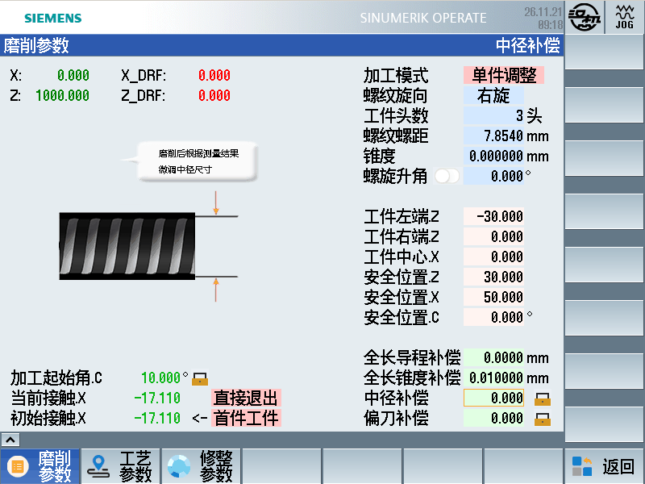
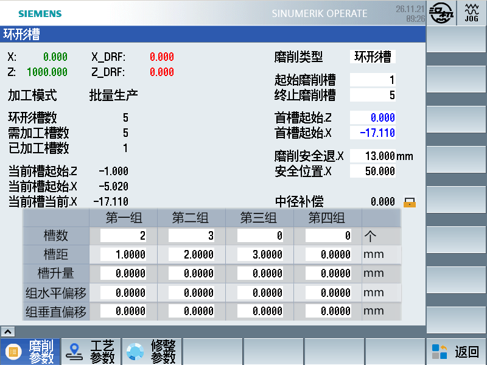
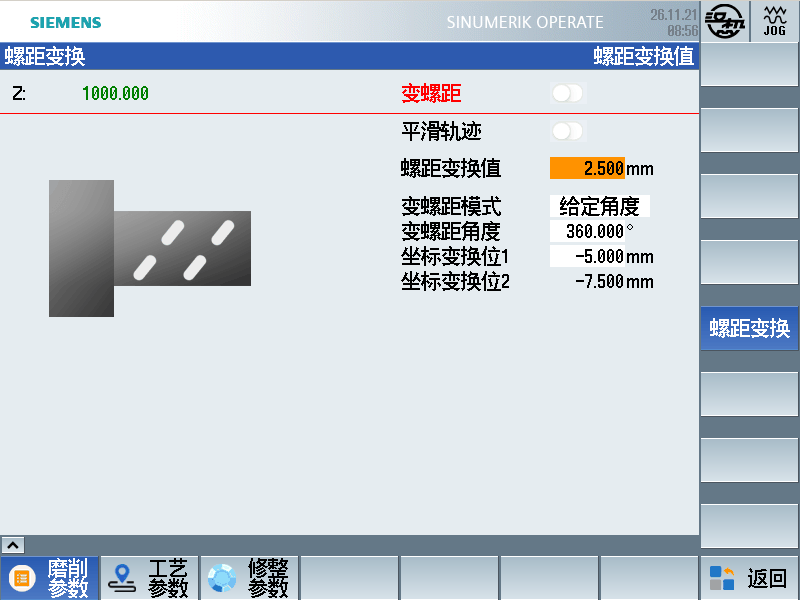
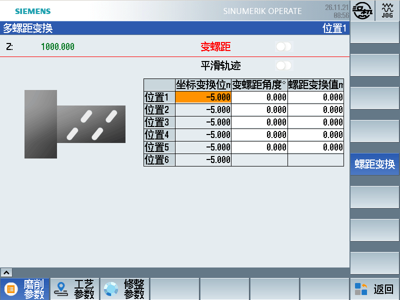
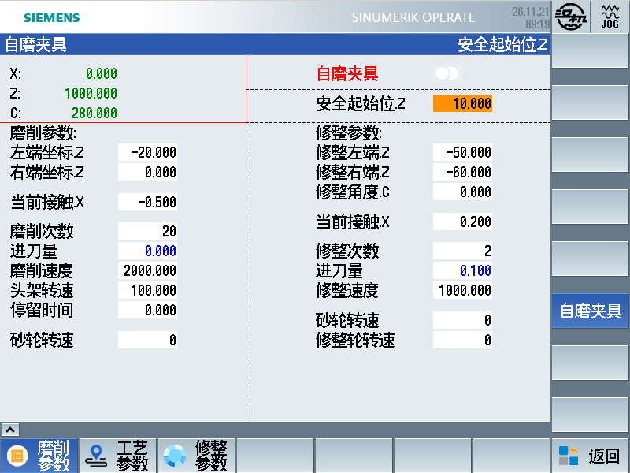
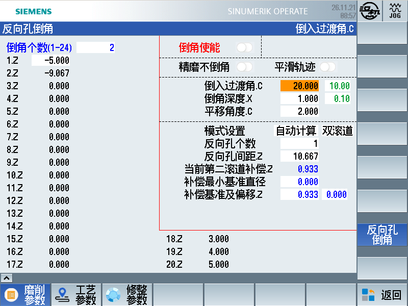
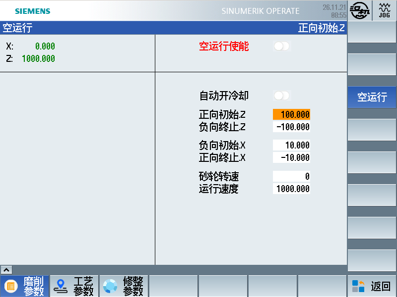
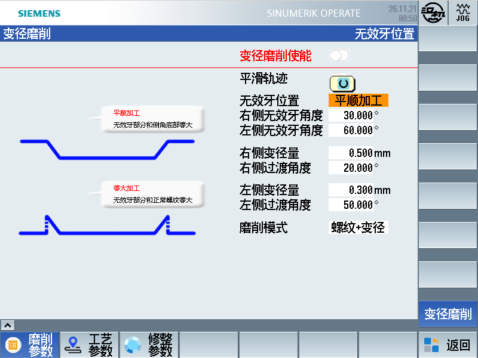
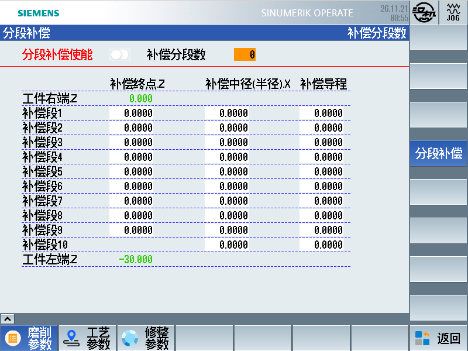

[HMI界面参数定义](index.html)

---

磨削界面

---

具体操作步骤请参考[磨削](section_12.html)，扩展功能操作请参考[磨削扩展功能](section_13.html)  
在用户界面中点击屏幕下方 **磨削参数** 软键进入本页

---

磨削主界面

---

  

界面左上角实时显示 X/Z 轴机床坐标及 DRF（手轮偏移）值，用于手动测量记录各位置坐标  
程序运行中（循环启动指示有效）时，工件与位置类参数自动变为只读，停止后恢复可编辑  
底部绿色区域（加工起始角.C/当前接触.X/初始接触.X）为对刀结果，默认锁定只读

|  |  |
| --- | --- |
| 加工模式 | 推荐设置：无 |
| 取值范围 | 单件调整/批量生产 |

决定每次启动程序时砂轮从哪个 X 位置开始进刀  
**单件调整**：从上一次加工结束时的当前磨削位（当前接触.X）继续进刀，适合首件试磨、反复补磨同一工件  
**批量生产**：每次启动先把当前接触.X 复位为初始接触.X，并清零工艺累计进刀量，每个新工件都从对刀位开始完整加工  
首件试磨合格后再切换为批量生产  
*修改权限：钥匙开关3档及以上*

|  |  |
| --- | --- |
| 螺纹旋向 | 推荐设置：无 |
| 取值范围 | 右旋/左旋 |

按工件图纸设置。旋向决定 C 轴与 Z 轴联动方向，并自动决定磨削起点在工件左端还是右端  
*修改权限：钥匙开关3档及以上*

|  |  |
| --- | --- |
| 工件头数 | 推荐设置：无 |
| 取值范围 | 1~100 |

按工件图纸设置螺纹线数。程序以 导程 = 头数 × 螺距 计算 C 轴转角，多头螺纹按头数依次分度磨削  
*修改权限：钥匙开关3档及以上*

|  |  |
| --- | --- |
| 螺纹螺距 | 推荐设置：无 |
| 取值范围 | 0~100（单位：mm） |

按工件图纸设置螺距（相邻两牙距离，不是导程）  

*修改权限：钥匙开关3档及以上*

|  |  |
| --- | --- |
| 锥度 | 推荐设置：按工件图纸 |
| 取值范围 | -10~10 |

锥螺纹磨削时输入，直螺纹输入 0  
输入值为工件单位长度上半径方向的变化量：锥度比 1:16 时输入 1/16/2 = 0.03125  
已知两端直径时：(大端直径 - 小端直径) / 长度 / 2  

内螺纹按大头往小头方向磨削，大头往小头输入正值，反之为负  

全长 X 方向增量 = 磨削长度 × 锥度 + 全长锥度补偿  
*修改权限：钥匙开关3档及以上*

|  |  |
| --- | --- |
| 螺旋升角（开关） | 推荐设置：无 |
| 取值范围 | 开/关 |

**开**：根据头数、螺距和工件中径自动计算螺旋升角，升角 = arctan(头数 × 螺距 / (π × 工件中径))  
**关**：螺旋升角手动输入  
*修改权限：钥匙开关3档及以上*

|  |  |
| --- | --- |
| 螺旋升角 | 推荐设置：无 |
| 取值范围 | -90~90（单位：°） |

磨削和对刀前，带 A 轴的机床会将砂轮架摆动到此角度；同时用于修整时法向齿形换算  

带 A 轴的机床，启动对刀/磨削时会自动松开液压锁紧并摆到此角度  

*修改权限：钥匙开关3档及以上*

|  |  |
| --- | --- |
| 工件中径 | 推荐设置：无 |
| 取值范围 | 0~500（单位：mm） |

仅用于螺旋升角自动计算，打开螺旋升角开关后输入，关闭时此项不可编辑  
*修改权限：钥匙开关3档及以上*

|  |  |
| --- | --- |
| 工件左端.Z | 推荐设置：无 |
| 取值范围 | -2000~2000（单位：mm） |

手动将砂轮中心移到工件螺纹左端需磨削的位置，记录此时 Z 轴机床坐标  
左右端之差即磨削长度，需保证砂轮能完整磨出整段螺纹  
*修改权限：钥匙开关3档及以上*

|  |  |
| --- | --- |
| 工件右端.Z | 推荐设置：无 |
| 取值范围 | -2000~2000（单位：mm） |

手动将砂轮中心移到工件螺纹右端需磨削的位置，记录此时 Z 轴机床坐标  
程序根据旋向自动决定从左端还是右端开始磨削  
*修改权限：钥匙开关3档及以上*

|  |  |
| --- | --- |
| 工件中心.X | 推荐设置：砂轮中心与头架中心重合时的 X 坐标 |
| 取值范围 | 无（单位：mm） |

内螺纹时砂轮在此 X 位置沿 Z 向进出工件内孔，必须设置准确  
测量方法：X 轴移动使砂轮接触工件内孔壁记录 X1，测量内孔直径 D1 和砂轮直径 D2  
工件中心 = X1 ± (D1 - D2) / 2（向孔中心方向取值）  
*修改权限：钥匙开关3档及以上*

|  |  |
| --- | --- |
| 安全位置.Z | 推荐设置：砂轮完全退出工件外 |
| 取值范围 | -2000~2000（单位：mm） |

内螺纹磨削开始、修整和退出时，Z 轴先运动到此位置，砂轮在此处离开工件内孔  
至少比工件右端多出 30mm，保证砂轮在此位置可以安全进行 X 向移动  
*修改权限：钥匙开关3档及以上*

|  |  |
| --- | --- |
| 安全位置.X | 推荐设置：X 轴远离工件位置 |
| 取值范围 | 无（单位：mm） |

程序启动、加工结束和异常退出时 X 轴退到的安全位置  
推荐设置到相对靠后的位置，保证 Z 轴、C 轴及上下料运动不会与工件干涉  
*修改权限：钥匙开关3档及以上*

|  |  |
| --- | --- |
| 安全位置.C（工件装夹角度） | 推荐设置：方便上下工件的角度 |
| 取值范围 | 0~360（单位：°） |

程序执行结束后头架（C 轴）转到此角度，便于拆装工件或机械手抓取  
*修改权限：钥匙开关3档及以上*

|  |  |
| --- | --- |
| 全长导程补偿 | 推荐设置：按检测报告 |
| 取值范围 | -500~500（单位：mm） |

用于修正全长范围内的螺距累积误差，输入检测报告中全长导程误差值  
程序以 C 轴总转角 = 360 × (磨削长度 - 补偿值) / 导程 计算，正值使相同长度内 C 轴转角减小、实际导程变大，负值反之

|  |  |
| --- | --- |
| 全长锥度补偿 | 推荐设置：按测量情况 |
| 取值范围 | -9~9（单位：mm） |

加工后测量两端中径存在差值时使用，输入值为全长范围内半径方向的补偿量  
与锥度叠加：X 方向总增量 = 磨削长度 × 锥度 + 全长锥度补偿

|  |  |
| --- | --- |
| 退出方式 | 推荐设置：按砂轮与内孔大小 |
| 取值范围 | 直接退出/螺旋退出 |

控制砂轮磨到螺纹终点后如何退出工件内孔  
**直接退出**：X 回到工件中心后 Z 直线退出，砂轮直径小于工件内孔时使用  
**螺旋退出**：沿螺纹螺旋线退出，砂轮直径大于内孔或退出路径有台阶时使用  
*修改权限：钥匙开关3档及以上*

补偿与对刀结果

---

|  |  |
| --- | --- |
| 中径补偿 | 推荐设置：无 |
| 取值范围 | 默认 ±1（限制值可在机床配置中修改）（单位：mm） |

加工后测量工件中径与目标值不符时，无需修改工艺进刀量，直接在此输入直径方向的差值  
正值使工件中径变大（外螺纹少磨、内螺纹多磨），负值使中径变小  
例：外螺纹实测中径比目标大 0.02mm，输入 -0.02  
为单次补偿：下次磨削开始时把补偿量的一半累加到当前接触.X 和初始接触.X 后自动清零（单独修整、对刀时不处理，保留到磨削时生效）  
需先点击右侧锁形图标解锁才能输入

|  |  |
| --- | --- |
| 偏刀补偿 | 推荐设置：无 |
| 取值范围 | -100~100（单位：mm） |

加工后测量发现螺纹牙两侧磨削不均（偏刀）时输入 Z 向偏移量  
程序把 Z 偏移按 角度 = 偏移 / 导程 × 360 换算并累加到加工起始角.C，使砂轮相对螺旋槽轴向偏移  
为单次补偿：下次磨削开始时累加到加工起始角.C 后自动清零；需先点击右侧锁形图标解锁才能输入

|  |  |
| --- | --- |
| 参数锁定开关 | 推荐设置：无 |
| 取值范围 | 打开/闭合 |

锁形图标位于中径补偿、偏刀补偿和对刀结果区域旁，防止误改关键数值  
闭合（默认）：对应参数只读；点击打开后可修改，离开界面重新进入后自动恢复锁定

|  |  |
| --- | --- |
| 加工起始角.C | 推荐设置：无 |
| 取值范围 | 0~360（单位：°） |

对刀完成后自动计算的 C 轴磨削起始角，保证砂轮准确进入螺旋槽  
一般无需手动修改；偏刀补偿会自动修正此值  
*修改权限：钥匙开关3档及以上*

|  |  |
| --- | --- |
| 当前接触.X | 推荐设置：无 |
| 取值范围 | 无（单位：mm） |

当前砂轮进入工件的磨削位置，每次进刀后自动更新  
单件调整模式下，启动程序从此位置继续加工  
*修改权限：钥匙开关3档及以上*

|  |  |
| --- | --- |
| 初始接触.X | 推荐设置：无 |
| 取值范围 | 无（单位：mm） |

对刀完成时记录的砂轮与工件初始接触位置  
批量生产模式下，每次启动程序从此位置开始；修整砂轮后程序按修整量自动补偿此值  
*修改权限：钥匙开关3档及以上*

|  |  |
| --- | --- |
| 是否是批量中的首件工件 | 推荐设置：无 |
| 取值范围 | 首件工件/不是首件 |

用于批量生产中每件都需手动对刀、又要保持尺寸一致的情况  
**首件工件**：对刀后重新计算初始接触.X 和加工起始角.C  
**不是首件**：对刀只重新计算起始角，初始接触.X 保留首件的值，保证批量尺寸一致  
*修改权限：钥匙开关3档及以上*

磨削类型选择

---

|  |  |
| --- | --- |
| 磨削类型（机型） | 推荐设置：无 |
| 取值范围 | 外螺纹/内螺纹/蜗杆/外圆/环形槽 |

显示当前程序的磨削类型，由机床配置生成，一般无需修改  
*修改权限：钥匙开关3档及以上*

|  |  |
| --- | --- |
| 磨削类型 | 推荐设置：无 |
| 取值范围 | 螺纹/环形槽 |

选择环形槽后自动跳转到环形槽参数界面，磨削时按环形槽方式逐槽加工  
此选项需在机床配置中开启环形槽功能后才可切换  
*修改权限：钥匙开关3档及以上*

环形槽参数界面

---

  

需在机床配置中开启 **环形槽加工** 后，磨削类型才能选择环形槽  
磨削类型选择环形槽后自动进入本界面。左侧为当前加工状态（只读）：环形槽数、需加工槽数、已加工槽数、当前槽起始 Z/X 及当前 X  
环形槽按最多 4 组设置，每组内为等距同参数的槽，程序由首槽位置及各组参数自动推算每个槽的 Z/X 位置

|  |  |
| --- | --- |
| 起始磨削槽 | 推荐设置：1 |
| 取值范围 | ≥ 1 |

从第几个槽开始磨削（从磨削起始端数起）。新工件设为 1，只补磨部分槽时设为需补磨的第一个槽号  
*修改权限：钥匙开关3档及以上*

|  |  |
| --- | --- |
| 终止磨削槽 | 推荐设置：无 |
| 取值范围 | ≥ 起始磨削槽 |

磨削到第几个槽结束。需加工槽数 = 终止磨削槽 - 起始磨削槽 + 1  
*修改权限：钥匙开关3档及以上*

|  |  |
| --- | --- |
| 首槽起始.Z | 推荐设置：无 |
| 取值范围 | 无（单位：mm） |

第一个槽的 Z 向磨削位置，手动将砂轮对准第一个槽中心后记录 Z 坐标  
*修改权限：钥匙开关3档及以上*

|  |  |
| --- | --- |
| 首槽起始.X | 推荐设置：无 |
| 取值范围 | 无（单位：mm） |

第一个槽的 X 向初始磨削接触位置，手动将砂轮接触第一个槽后记录 X 坐标；其余槽按垂直偏移与槽升量推算  
*修改权限：钥匙开关3档及以上*

|  |  |
| --- | --- |
| 槽数（第一组~第四组） | 推荐设置：无 |
| 取值范围 | ≥ 0 |

每组内的槽个数，不用的组设为 0  
*修改权限：钥匙开关3档及以上*

|  |  |
| --- | --- |
| 槽距 / 槽升量（第一组~第四组） | 推荐设置：无 |
| 取值范围 | 槽距大于 0（单位：mm） |

**槽距**：该组相邻两槽的 Z 向间距  
**槽升量**：该组相邻两槽的 X 向（半径）递增量，用于槽底直径逐槽变化的工件，等径槽输入 0  
*修改权限：钥匙开关3档及以上*

|  |  |
| --- | --- |
| 组水平偏移（第一组~第四组） | 推荐设置：无 |
| 取值范围 | 无（单位：mm） |

该组第一个槽相对上一组最后一个槽额外的 Z 向偏移量，用于组与组之间的间距与组内螺距不同的情况  
*修改权限：钥匙开关3档及以上*

|  |  |
| --- | --- |
| 组垂直偏移（第一组~第四组） | 推荐设置：无 |
| 取值范围 | 无（单位：mm） |

该组第一个槽相对上一组最后一个槽额外的 X 向偏移量，用于不同组槽底直径不同的情况  
*修改权限：钥匙开关3档及以上*

|  |  |
| --- | --- |
| 环形槽状态（环形槽数/需加工槽数/已加工槽数/当前槽起始.Z/当前槽起始.X） | 推荐设置：无 |
| 取值范围 | 只读 |

左侧状态区实时显示：环形槽总数、本次需加工的槽数、已加工的槽数，以及当前正在磨削的槽的起始 Z、X 位置  
*界面只读显示，由程序自动写入*

螺距变换界面

---

  

用于中间有一段螺距与两端不同的工件。在机床配置中开启螺距变换后，磨削主界面右侧出现 **螺距变换** 软键  
磨削从起点到坐标变换位1 使用正常螺距，坐标变换位1 到 坐标变换位2 使用螺距变换值，坐标变换位2 到终点恢复正常螺距

|  |  |
| --- | --- |
| 变螺距 | 推荐设置：无 |
| 取值范围 | 关/开 |

打开后磨削按变螺距方式运行；变换位置设置不合理（不在磨削起终点之间或顺序颠倒）时程序报警停止  
*修改权限：钥匙开关3档及以上*

|  |  |
| --- | --- |
| 平滑轨迹 | 推荐设置：无 |
| 取值范围 | 关/开 |

打开后各段螺距衔接处按平滑曲线过渡，避免螺距突变处冲击  
第一次对位置、确认变换位置时建议关闭，便于观察实际变换点  
*修改权限：钥匙开关3档及以上*

|  |  |
| --- | --- |
| 螺距变换值 | 推荐设置：无 |
| 取值范围 | 0~100（单位：mm） |

变换段（坐标变换位1 与 2 之间）的螺距  
*修改权限：钥匙开关3档及以上*

|  |  |
| --- | --- |
| 变螺距模式 | 推荐设置：无 |
| 取值范围 | 给定角度/终点变换 |

**给定角度**：输入变换段对应的 C 轴旋转角度，坐标变换位2 由坐标变换位1、变换螺距和角度自动推算  
**终点变换**：从坐标变换位1 起一直到磨削终点都使用变换螺距  
*修改权限：钥匙开关3档及以上*

|  |  |
| --- | --- |
| 变螺距角度 | 推荐设置：无 |
| 取值范围 | ≥ 0（单位：°） |

给定角度模式下，变换段对应的 C 轴旋转角度  
*修改权限：钥匙开关3档及以上*

|  |  |
| --- | --- |
| 坐标变换位1 / 坐标变换位2 | 推荐设置：无 |
| 取值范围 | 在磨削起点与终点之间（单位：mm） |

变换段起点和终点的 Z 坐标。坐标变换位1 手动输入（砂轮对准螺距开始变化处记录 Z 坐标）  
坐标变换位2 由变螺距模式自动计算，只读显示  
*修改权限：钥匙开关3档及以上*

多螺距变换界面

---

  

用于中间连续多段螺距不同的工件，在机床配置中将螺距变换设为多段模式后，点击右侧 **螺距变换** 软键进入本界面  
从位置1 开始依次为 5 段变换段，每段按该段螺距和该段 C 轴角度推算下一段起点：位置(n+1) = 位置n ∓ 螺距n × 角度n / 360

|  |  |
| --- | --- |
| 位置1~位置6 | 推荐设置：无 |
| 取值范围 | 在磨削起点与终点之间（单位：mm） |

位置1 为第一段变换起点 Z 坐标，手动输入；位置2~位置6 根据各段螺距与角度自动计算，只读显示  
*修改权限：钥匙开关3档及以上*

|  |  |
| --- | --- |
| 各段角度 | 推荐设置：无 |
| 取值范围 | ≥ 0（单位：°） |

每段变换段对应的 C 轴旋转角度  
*修改权限：钥匙开关3档及以上*

|  |  |
| --- | --- |
| 各段螺距 | 推荐设置：无 |
| 取值范围 | 大于 0（单位：mm） |

每段变换段的螺距；不需要的段可将角度设为 0  
*修改权限：钥匙开关3档及以上*

自磨夹具界面

---

  

用于内螺纹机床用本机砂轮磨削（修正）夹具定位面。在机床配置中开启后，磨削主界面出现 **自磨夹具** 软键  
打开自磨夹具后启动程序，执行夹具磨削和夹具专用砂轮修整，不进行螺纹磨削；完成后务必关闭

|  |  |
| --- | --- |
| 自磨夹具 | 推荐设置：无 |
| 取值范围 | 关/开 |

打开后启动程序执行夹具磨削流程  
*修改权限：钥匙开关3档及以上*

|  |  |
| --- | --- |
| 安全起始位.Z | 推荐设置：无 |
| 取值范围 | 无（单位：mm） |

夹具磨削和夹具修整开始前 Z 轴先运动到的安全位置，须保证 X 轴移动不干涉  
*修改权限：钥匙开关3档及以上*

|  |  |
| --- | --- |
| 左端坐标.Z / 右端坐标.Z | 推荐设置：无 |
| 取值范围 | 无（单位：mm） |

砂轮在夹具磨削面左、右两端的 Z 坐标，磨削时 Z 轴在两端之间往复  
*修改权限：钥匙开关3档及以上*

|  |  |
| --- | --- |
| 当前接触.X（夹具磨削） | 推荐设置：无 |
| 取值范围 | 无（单位：mm） |

砂轮接触夹具磨削面的 X 坐标，每次进刀后自动累加  
*修改权限：钥匙开关3档及以上*

|  |  |
| --- | --- |
| 磨削次数 / 进刀量 | 推荐设置：无 |
| 取值范围 | 磨削次数 ≥ 1（单位：进刀量 mm） |

夹具磨削往复次数及每次 X 向进刀量  
*修改权限：钥匙开关3档及以上*

|  |  |
| --- | --- |
| 磨削速度 / 头架转速 / 停留时间 / 砂轮转速 | 推荐设置：无 |
| 取值范围 | 无 |

**磨削速度**：Z 轴往复速度（mm/min）  
**头架转速**：夹具磨削时头架旋转速度（r/min）  
**停留时间**：每次到达端点后的停留时间（s）  
**砂轮转速**：夹具磨削时砂轮转速（r/min）  
*修改权限：钥匙开关3档及以上*

|  |  |
| --- | --- |
| 修整左端.W / 修整右端.W / 修整角度.C | 推荐设置：无 |
| 取值范围 | 无 |

夹具磨削前修整砂轮时，修整器水平轴往复的左、右端坐标及头架修整器所在的 C 轴角度  
*修改权限：钥匙开关3档及以上*

|  |  |
| --- | --- |
| 当前接触.X（夹具修整）/ 修整次数 / 进刀量 | 推荐设置：无 |
| 取值范围 | 无 |

砂轮接触修整器的 X 坐标、修整次数及每次修整进刀量  
*修改权限：钥匙开关3档及以上*

|  |  |
| --- | --- |
| 修整速度 / 砂轮转速 / 修整轮转速 | 推荐设置：无 |
| 取值范围 | 无 |

夹具修整时修整轴移动速度、砂轮转速和修整轮转速；修整轮转速为 0 时不启动修整轮  
*修改权限：钥匙开关3档及以上*

反向孔倒角界面

---

  

用于滚珠螺母类内螺纹：螺纹与反向器孔相交处磨削时按设定位置让刀，形成倒角，避免锐边。在机床配置中开启后磨削主界面出现 **反向孔倒角** 软键  
每个倒角：X 轴在倒入过渡角.C 范围内斜向退出到倒角深度.X，保持平移角度.C 后再斜向回到螺纹

|  |  |
| --- | --- |
| 倒角使能 | 推荐设置：无 |
| 取值范围 | 关/开 |

打开后螺纹磨削按倒角位置自动让刀  
*修改权限：钥匙开关3档及以上*

|  |  |
| --- | --- |
| 精磨不倒角 | 推荐设置：无 |
| 取值范围 | 关/开 |

打开后精磨、终磨工序不再执行倒角让刀，仅粗磨及之前工序倒角  
*修改权限：钥匙开关3档及以上*

|  |  |
| --- | --- |
| 补偿.X（倒角终点补偿模式） | 推荐设置：无 |
| 取值范围 | 直接/渐变 |

倒角终点 X 向补偿的作用方式  
**直接**：倒角结束后立即叠加补偿量  
**渐变**：从本倒角结束到下一倒角开始之间逐渐过渡到补偿量  
需在机床配置中开启 **反向孔倒角 → 倒角-X向补偿参数显示** 后显示  
*修改权限：钥匙开关3档及以上*

|  |  |
| --- | --- |
| 平滑轨迹 | 推荐设置：无 |
| 取值范围 | 关/开 |

打开后倒角让刀路径按平滑曲线过渡；第一次确认倒角位置时建议关闭  
*修改权限：钥匙开关3档及以上*

|  |  |
| --- | --- |
| 倒入过渡角.C / 倒角深度.X / 平移角度.C | 推荐设置：无 |
| 取值范围 | 倒入过渡角 ≥ 0，平移角度 ≥ 2 |

**倒入过渡角.C**：倒角斜面对应的 C 轴转角，角度越大倒角斜面越缓  
**倒角深度.X**：倒角处 X 向让刀深度  
**平移角度.C**：保持倒角深度不变的 C 轴转角（倒角底部平台长度）  
*修改权限：钥匙开关3档及以上*

|  |  |
| --- | --- |
| 预倒角角度 / 预倒角深度 | 推荐设置：无 |
| 取值范围 | 预倒角角度 ≥ 0 |

倒角两端额外预倒角的 C 轴角度和 X 深度，用于倒角入口和出口的过渡  
*修改权限：钥匙开关3档及以上*

|  |  |
| --- | --- |
| 模式设置 | 推荐设置：无 |
| 取值范围 | 手动输入/自动计算/自动探测 |

**手动输入**：每个倒角的 Z 坐标在左侧 1.Z~20.Z 中逐一输入  
**自动计算**：只输入第 1 个倒角位置，后续位置按反向孔个数、孔间距和第二滚道补偿自动计算  

**自动探测**：由自动对刀测头探测基准孔位置后自动计算全部倒角位置  

*修改权限：钥匙开关3档及以上*

|  |  |
| --- | --- |
| 反向孔类型 | 推荐设置：无 |
| 取值范围 | 双滚道/单滚道 |

**双滚道**：每个反向孔对应两条相邻滚道（相差一圈）各一个倒角，孔间距相等  
**单滚道**：每孔一个倒角，各孔间距在下方倒角间距.Z 中逐个输入（最多 24 个）  
*修改权限：钥匙开关3档及以上*

|  |  |
| --- | --- |
| 反向孔个数 / 反向孔间距.Z | 推荐设置：无 |
| 取值范围 | 个数 1~12（单位：间距 mm） |

自动计算时使用：反向孔数量及相邻两孔 Z 向中心距  
*修改权限：钥匙开关3档及以上*

|  |  |
| --- | --- |
| 当前第二滚道补偿.Z | 推荐设置：无 |
| 取值范围 | 无（单位：mm） |

双滚道时第二个倒角相对第一个倒角（相差一圈）的 Z 向补偿量，按当前砂轮直径自动计算：  
补偿 = 补偿基准值.Z + (当前砂轮直径 - 补偿最小基准直径) × 补偿每毫米偏移.Z（砂轮直径不大于基准直径时取基准值）  
*界面只读显示，由程序自动写入*

|  |  |
| --- | --- |
| 补偿最小基准直径 / 补偿基准值.Z / 补偿每毫米偏移.Z | 推荐设置：无 |
| 取值范围 | 每毫米偏移 -0.5~0.5 |

用于计算第二滚道补偿：砂轮直径变化会改变砂轮与倒角的接触位置，按每毫米直径偏移量线性修正  
*修改权限：钥匙开关3档及以上*

|  |  |
| --- | --- |
| 测量基准孔-右侧 / 位置补偿.Z | 推荐设置：无 |
| 取值范围 | 基准孔 1~10 |

**测量基准孔-右侧**：自动探测时测量的是从右侧数第几个反向孔  
**位置补偿.Z**：第一个倒角位置的 Z 向微调量  
*修改权限：钥匙开关3档及以上*

|  |  |
| --- | --- |
| 倒角个数 / 1.Z~20.Z | 推荐设置：无 |
| 取值范围 | 倒角个数 1~24（单位：mm） |

倒角数量及每个倒角起点的 Z 坐标；手动输入模式下逐一输入，自动模式下由程序计算填写  
*修改权限：钥匙开关3档及以上*

|  |  |
| --- | --- |
| 倒角间距.Z（单滚道） | 推荐设置：无 |
| 取值范围 | 0~100（单位：mm） |

单滚道不等距时相邻两个倒角之间的 Z 向距离  
*修改权限：钥匙开关3档及以上*

|  |  |
| --- | --- |
| 倒角终点补偿.X | 推荐设置：无 |
| 取值范围 | -0.1~0.1（单位：mm） |

第 1~20 个倒角结束后 X 向补偿量，用于修正倒角两侧螺纹尺寸差异，作用方式由补偿.X 选择  
需在机床配置中开启 **反向孔倒角 → 倒角-X向补偿参数显示** 后显示  
*修改权限：钥匙开关3档及以上*

空运行界面

---

  

用于开机热机：机床按设定范围空载往复运行，使主轴、导轨温度稳定。在机床配置中开启后磨削主界面出现 **空运行** 软键

|  |  |
| --- | --- |
| 空运行使能 | 推荐设置：无 |
| 取值范围 | 关/开 |

打开后启动程序执行空运行热机，不进行磨削；热机结束务必关闭

|  |  |
| --- | --- |
| 自动卡爪 | 推荐设置：无 |
| 取值范围 | 关/开 |

空运行期间卡盘是否自动松开/夹紧动作，用于同时预热液压卡盘  
*修改权限：钥匙开关3档及以上*

|  |  |
| --- | --- |
| 自动开冷却 | 推荐设置：无 |
| 取值范围 | 关/开 |

空运行期间是否自动打开冷却液  
*修改权限：钥匙开关3档及以上*

|  |  |
| --- | --- |
| 正向初始.Z / 负向终止.Z | 推荐设置：无 |
| 取值范围 | 无（单位：mm） |

空运行时 Z 轴往复的起点与终点，Z 轴运动时 C 轴同步旋转  
*修改权限：钥匙开关3档及以上*

|  |  |
| --- | --- |
| 负向初始.X / 正向终止.X | 推荐设置：无 |
| 取值范围 | 无（单位：mm） |

空运行时 X 轴往复的后方起点与前方终点，须保证不碰工件和夹具  
*修改权限：钥匙开关3档及以上*

|  |  |
| --- | --- |
| 砂轮转速 / 运行速度 | 推荐设置：无 |
| 取值范围 | ≥ 0 |

空运行时砂轮转速（r/min）及各轴往复速度（mm/min）  
*修改权限：钥匙开关3档及以上*

变径磨削界面

---

  

用于螺纹两端需要逐渐减小牙深（收尾）的工件：两端按设定角度范围让刀，形成过渡。在机床配置中开启后磨削主界面出现 **变径磨削** 软键  
每端依次为 无效牙段 → 过渡段（逐渐进刀到正常深度）→ 正常螺纹段

|  |  |
| --- | --- |
| 变径磨削使能 | 推荐设置：无 |
| 取值范围 | 关/开 |

打开后螺纹两端按下方参数变径磨削

|  |  |
| --- | --- |
| 平滑轨迹 | 推荐设置：无 |
| 取值范围 | 关/开 |

打开后变径段按平滑曲线过渡；第一次确认变径位置时建议关闭  
*修改权限：钥匙开关3档及以上*

|  |  |
| --- | --- |
| 无效牙位置 | 推荐设置：无 |
| 取值范围 | 平顺加工/等大加工 |

端部无效牙段的处理方式  
**平顺加工**：无效牙段保持变径后的退让量  
**等大加工**：无效牙段按正常螺纹深度磨削

|  |  |
| --- | --- |
| 右侧/左侧无效牙角度 | 推荐设置：无 |
| 取值范围 | ≥ 0（单位：°） |

螺纹右端、左端无效牙段对应的 C 轴转角，Z 向长度 = 角度 / 360 × 导程  
*修改权限：钥匙开关3档及以上*

|  |  |
| --- | --- |
| 右侧/左侧变径量 | 推荐设置：无 |
| 取值范围 | -2~2（单位：mm） |

端部相对正常螺纹的 X 向让刀量，正值表示向后退刀（牙变浅）  
*修改权限：钥匙开关3档及以上*

|  |  |
| --- | --- |
| 右侧/左侧过渡角度 | 推荐设置：无 |
| 取值范围 | ≥ 0（单位：°） |

从变径量过渡到正常深度所对应的 C 轴转角，角度越大过渡越平缓  
*修改权限：钥匙开关3档及以上*

|  |  |
| --- | --- |
| 磨削模式 | 推荐设置：无 |
| 取值范围 | 螺纹+变径/单独变径 |

**螺纹+变径**：每刀都按变径轨迹磨削整条螺纹  
**单独变径**：先完成正常螺纹磨削，再单独磨削两端变径段  
*修改权限：钥匙开关3档及以上*

|  |  |
| --- | --- |
| 变径磨削次数 | 推荐设置：无 |
| 取值范围 | 1~100 |

单独变径模式下变径段的磨削次数  
*修改权限：钥匙开关3档及以上*

分段补偿界面

---

  

用于长螺纹按检测结果对不同区段分别补偿中径和导程。在机床配置中开启后磨削主界面出现 **分段补偿** 软键  
工件从右端到左端最多分为 10 段，界面中工件右端.Z/左端.Z 只读显示磨削范围  
分段补偿只作用于普通螺纹磨削轨迹：同时打开反向孔倒角、变径磨削（螺纹+变径模式）或变螺距时，这些磨削不执行分段补偿

|  |  |
| --- | --- |
| 分段补偿使能 | 推荐设置：无 |
| 取值范围 | 关/开 |

打开后磨削按分段补偿轨迹运行（手动对刀时不生效，与反向孔倒角、变径磨削、变螺距不同时生效）

|  |  |
| --- | --- |
| 补偿分段数 | 推荐设置：无 |
| 取值范围 | 0~10 |

整个磨削长度分为几段

|  |  |
| --- | --- |
| 补偿段.Z | 推荐设置：无 |
| 取值范围 | 在工件左右端之间（单位：mm） |

第 n 段与第 n+1 段分界处的 Z 坐标（从右端起），最后一段终点为工件左端，因此只需输入 分段数 - 1 个分界  
*修改权限：钥匙开关3档及以上*

|  |  |
| --- | --- |
| 补偿段中径补偿量 | 推荐设置：无 |
| 取值范围 | 无（单位：mm） |

第 n 段终点相对磨削起点的 X 向（半径）累计补偿量，段内线性过渡  
*修改权限：钥匙开关3档及以上*

|  |  |
| --- | --- |
| 补偿段导程补偿量 | 推荐设置：无 |
| 取值范围 | 无（单位：mm） |

第 n 段的导程修正量，正值使该段实际导程增大，负值减小  
*修改权限：钥匙开关3档及以上*
