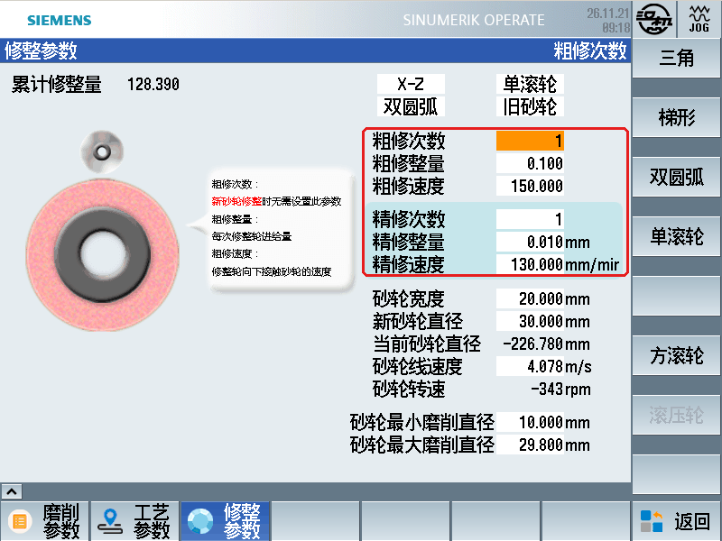
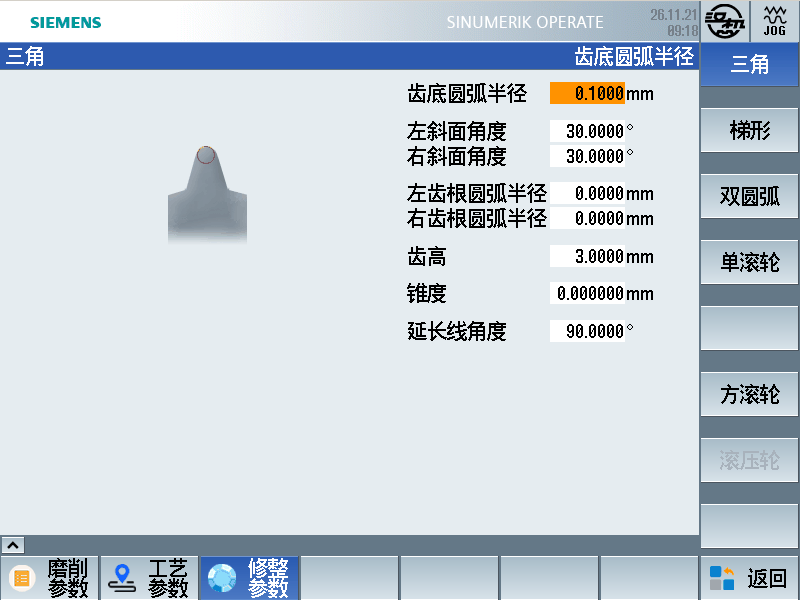
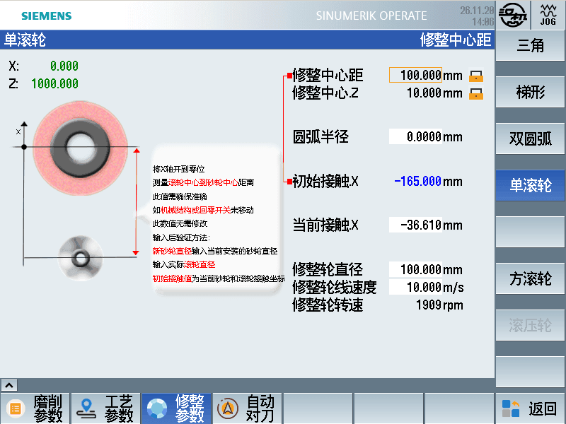
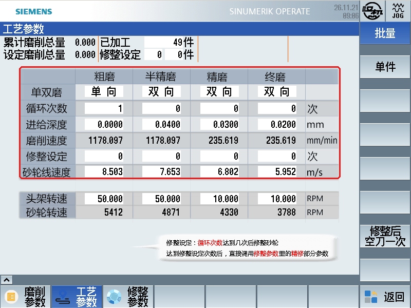

[机床功能介绍](index.html)

---

砂轮修整

---

具体参数设置请参考[修整界面](section_3.html)、[滚轮界面](section_4.html)、[齿型界面](section_6.html)

---

修整方式说明

---

| 修整方式 | 何时执行 | 使用的参数 |
| --- | --- | --- |
| 新砂轮修整 | 更换砂轮后单独执行一次 | 修整界面粗修 + 精修参数（新砂轮从外圆逐层修出完整齿形） |
| 旧砂轮修整 | 需要恢复砂轮齿形时单独执行 | 修整界面粗修 + 精修参数 |
| 磨削中修整 | 磨削中按工艺界面修整设定自动执行 | 修整界面精修参数（扩展工艺时用工艺表各工序修整参数） |
| 按件数修整 | 每加工设定件数后，在下一件开始前自动执行 | 修整界面精修参数 |

新砂轮修整

---

1. 安装新砂轮后，点击屏幕下方 **修整参数** 进入修整界面
  
  
红框：单独修整时使用的粗修、精修参数  
  

2. 选择 [修整器类型](section_3.html#S3D2)：碟形修整轮插补修整选 **X-W**，成型滚压轮选 **成型X**
3. 插补修整：选择 [修整轮类型](section_3.html#S3D3) 和 [齿形](section_3.html#S3D4)，点击右侧对应齿形软键设置齿形参数
  
  
  
4. 点击右侧对应修整轮软键（单滚轮/方滚轮/双滚轮/滚压轮），按图纸输入修整轮直径、圆弧半径或齿高等参数
  
  
  
5. 标定修整轮位置：设置 [修整中心距](section_4.html#S4D12) 和 [修整中心](section_4.html#S4D13)

修整中心距：测量新砂轮直径 D1 输入修整界面新砂轮直径；输入修整轮直径 D2；移动 X 轴使砂轮刚好接触修整轮外沿，把 X 坐标 X1 输入 **当前接触.X**  

修整中心距 = |X1 + D1/2 + D2/2|  

设置后滚轮界面的 **初始接触.X** 应等于刚才输入的 X1，相等即正确  
修整中心：用修整轮左右侧面分别轻触砂轮两端面，记录 Z1、Z2，修整中心 = (Z1 + Z2) / 2

6. 返回修整界面，将 [砂轮状态](section_3.html#S3D16) 设为 **新砂轮**
7. 输入 [新砂轮直径](section_3.html#S3D14)（比实测大 0.2mm 左右）、[砂轮宽度](section_3.html#S3D13)、[砂轮线速度](section_3.html#S3D15)（通常 22m/s 左右）
8. 设置 [砂轮最小磨削直径](section_3.html#S3D5)，砂轮小于此直径时报警
9. 设置 [砂轮最大磨削直径](section_3.html#S3D6)：新砂轮修整时自动修到此直径，保证能进入工件内孔
10. 设置粗修、精修的次数、修整量和速度

内螺纹新砂轮修整时，程序按 (新砂轮直径 - 砂轮最大磨削直径) / 2 自动计算粗修、精修次数（最后约 5 次为精修），界面上输入的粗修、精修次数不起作用

11. 点亮机床操作面板上的 **修整** 键，按 **循环启动**，机床自动完成修整

修整开始第一刀后砂轮状态即自动变为旧砂轮，砂轮直径和磨削位置随每次修整自动更新；中途停止后再次启动，按旧砂轮从当前接触位置继续修整  
机床配置开启"结束自动关闭修整/对刀键"时，修整键自动熄灭

旧砂轮修整

---

1. 在修整界面确认砂轮状态为 **旧砂轮**
2. 设置粗修次数和精修次数及修整量
3. 点亮 **修整** 键，按 **循环启动**；修整从滚轮界面的当前接触位置开始

磨削中修整

---

1. 在 [工艺界面](section_2.html#S2D6) 设置各工序的 **修整设定**（每磨几次修整一次），0 表示该工序不修整
  
  
红框：各工序（粗磨、半精磨、精磨、终磨）的工艺参数表  
  
2. 在工艺界面设置 [修整设定-大砂轮 / 小砂轮](section_2.html#S2D2)，可实现每加工几件自动修整一次
3. 磨削中修整只执行精修，使用修整界面精修次数、精修整量、精修速度；扩展工艺时按工序修整使用工艺表中各工序的修整参数，按件数修整仍使用修整界面精修参数
4. 需要修整后先空磨一刀再进刀时，点亮工艺界面右侧 **修整后空刀一次** 软键（按头数修整时无效）
5. 每道工序的修整计数在该工序结束时清零，不会累计到下一道工序；按件数修整在一个工件磨完后计数，到达设定件数时在下一件磨削开始前修整

修整无法启动的常见原因

---

启动修整后报警或不动作时，检查：

1. 磨削界面的工件螺距、工件左右端、退刀位置等未设置合适值（可先临时设置大概值完成修整）
2. 修整中心距 / 修整中心设置错误，或正负号写反
3. 当前砂轮直径大于砂轮最大磨削直径，或小于最小磨削直径
