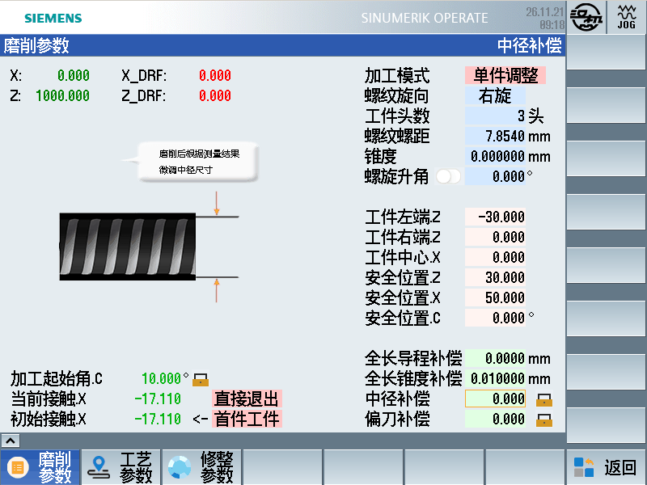
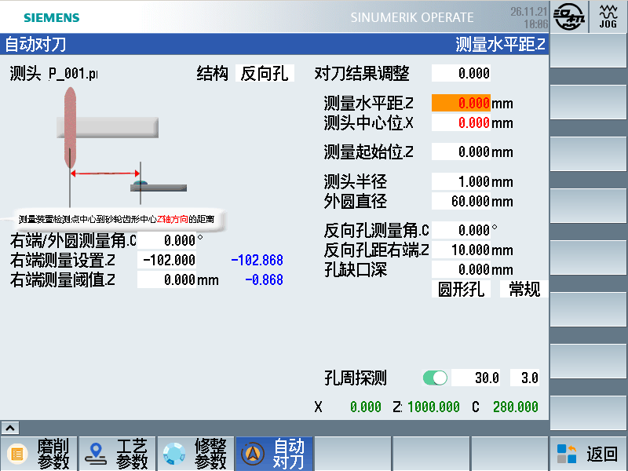

[机床功能介绍](index.html)

---

对刀

---

具体参数设置请参考[磨削界面](section_1.html)、[自动对刀界面](section_5.html)  
对刀的目的：让砂轮准确进入工件已有的螺纹槽（或确定首次磨削的起始角），程序据此计算 **加工起始角.C** 和 **初始接触.X**

---

手动对刀

---

1. 进入磨削界面，设置工件基本参数：[螺距](section_1.html#S1D4)、[旋向](section_1.html#S1D8)、[头数](section_1.html#S1D9)、[锥度](section_1.html#S1D16)、[螺旋升角](section_1.html#S1D20)
  
  
  

2. 设置 [工件中心.X](section_1.html#S1D28)：砂轮从这里进出工件内孔，需按测量方法准确设置
3. 手动将 X 轴退到不会干涉的安全位置，记录 X 坐标到 [安全位置.X](section_1.html#S1D14)
4. 移动 Z 轴分别对准螺纹左右两端，记录到 [工件左端.Z](section_1.html#S1D10) 和 [工件右端.Z](section_1.html#S1D11)
5. 设置 [安全位置.Z](section_1.html#S1D30)（砂轮完全在工件外）
6. 点亮操作面板上的 **手动对刀** 键，按 **循环启动**
7. 点亮 **DRF**（手轮）键，选择合适的手轮倍率（×1 / ×10 / ×100），并将进给倍率调到最小
8. 程序先将 Z 轴移到安全位置.Z，X 轴移到工件中心.X，再将 Z 轴移入工件磨削起点，头架转到加工起始角
9. 砂轮开始沿螺纹与头架同步插补运动后，用手轮微调 X 轴（必要时 Z 轴），使砂轮刚好落入工件螺纹槽中，两侧无挤压
10. 砂轮落入槽中后按操作面板上的 **退刀** 键：程序立即记录当前位置，计算加工起始角后退出工件，程序结束；不按退刀键时，砂轮走完整段螺纹后按终点位置计算并退出。最后关闭手动对刀键
11. 程序自动计算并保存 [加工起始角.C](section_1.html#S1D24) 和 [初始接触.X](section_1.html#S1D26)

提示：  
摇手轮时把进给倍率调到最小；砂轮放入槽内后可将 X 轴后退约 0.1mm 再提高倍率，观察后段是否有挤压  
对刀时砂轮转速由机床程序设定，必要时联系制造商调整  
机床配置中可选择 **插补对刀**（砂轮与头架同步转动中对刀）或 **静止对刀**（静止状态下对刀）；静止对刀时程序到位后暂停，用手轮调整好位置后再按循环启动，程序记录位置并结束  
首件工件对刀时，头架转到当前加工起始角（机床配置也可设为从 0° 开始对刀）；非首件对刀时，机床配置可设为 X 轴直接开到初始接触.X，减少手轮调整量

批量生产中的对刀

---

1. 首件工件对刀前，将 [是否是批量中的首件工件](section_1.html#S1D27) 设为 **首件工件**，对刀后保存初始接触.X 和起始角
2. 后续每件仍需手动对刀时设为 **不是首件**：对刀只更新起始角，初始接触.X 保持首件的值，保证批量尺寸一致

自动对刀

---

1. 点击屏幕下方 **自动对刀** 进入自动对刀界面
  
  
  

2. 按工件定位基准选择 [结构](section_5.html#S5D41)：螺纹槽定位选 **内滚道**，反向孔等定位选 **反向孔**；需要时再选择 [测量模式](section_5.html#S5D42)
3. 标定 [测量水平距.Z](section_5.html#S5D6)（新机床或更换测量机构后标定一次）；反向孔方式还需标定 [测头中心位.X](section_5.html#S5D24)
4. 内滚道方式：手动把开关伸入工件对准第一个螺纹槽，记录 [测量位.Z](section_5.html#S5D7)，靠近孔壁到刚有信号后再进约 0.2mm，记录 [测量位.X](section_5.html#S5D9)
5. 反向孔方式：输入测头半径、外圆直径、反向孔位置等参数，并手动用测头接触右端面后输入 [右端测量设置.Z](section_5.html#S5D37)
6. 先用手动对刀磨一件，确认无偏刀后再使用自动对刀
7. 点亮操作面板上的 **自动对刀** 键，按 **循环启动**：测量机构伸出，自动测量并计算加工起始角，完成后测量机构退回
8. 磨削后如有偏刀，在 [对刀结果调整](section_5.html#S5D1) 中修正，之后每次自动对刀都会叠加此修正值
9. 机床配置开启 **自动对刀后直接磨削** 时，测量完成后直接开始磨削；否则测量完成后程序结束，再按循环启动磨削

自动对刀常见提示与处理：

| 提示 | 原因与处理 |
| --- | --- |

| 检测不到信号,检查测量位.X是否合适! | 内滚道方式沿 Z 向两侧找不到螺纹槽牙侧：检查测量位.Z 是否在槽内、测量位.X 是否超过孔壁 |
| 测量失败, 请检查测量位置设置是否合适 | 内滚道方式反复碰到牙顶（已平移 5 次）：重新确认测量位.Z 是否对准螺纹槽 |
| 工件外径设置有误! | 测头在预计位置找不到右端面、孔壁或台阶：检查外圆直径、测头中心位.X、测头半径、反向孔距右端.Z |
| 测头无法进入孔内,请检查参数设置! | 测头伸不进反向孔或右端孔：检查反向孔距右端.Z、反向孔测量角.C、孔缺口深，必要时打开孔周探测 |
| 测量错误,测头未检测到信号 | 外圆面右端反模式找不到找平面或右端反向器端面：检查外圆找平、端反测量各位置 |
| 工件右端过长，检查是否放置有误或重新设置右端磨削位置 | 测得的右端面比右端测量设置偏出超过阈值：检查工件装夹，或重新测量后修改右端测量设置 |
