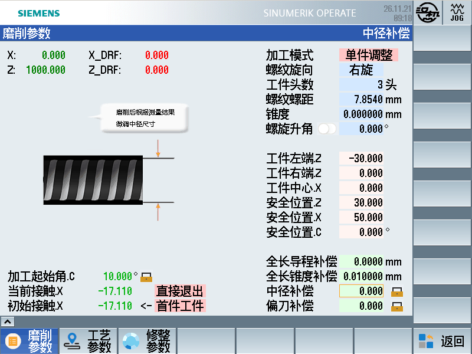
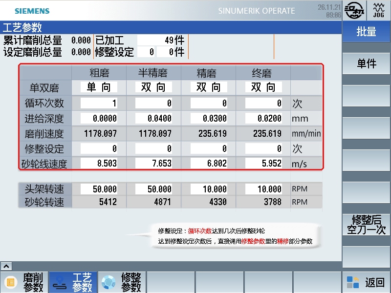

[机床功能介绍](index.html)

---

磨削

---

具体参数设置请参考[磨削界面](section_1.html)、[工艺界面](section_2.html)

---

磨削步骤

---

1. 磨削前须完成新砂轮修整和对刀
2. 在磨削界面选择 [加工模式](section_1.html#S1D1)：首件试磨用 **单件调整**，确认尺寸后改为 **批量生产**
  
  
  

3. 进入工艺界面，按工件余量设置粗磨、半精磨、精磨、终磨的单双磨、循环次数、进给深度、修整设定、砂轮线速度和头架转速
  
  
红框：各工序（粗磨、半精磨、精磨、终磨）的工艺参数表  
  
4. 关闭修整、对刀键，按 **循环启动** 开始磨削
5. 磨削过程中屏幕提示行显示当前工序、循环次数和进给量
6. 加工完成后测量工件，按测量结果调整（见下方"磨削后的调整"）

工艺设置要点：  
进给深度为单边（半径方向）进给量  
双向磨削时，进给深度的含义由机床配置决定（往返总进给或每个方向的进给）  
修整设定：例如粗磨循环 5 次、修整设定 2，则在第 2、第 4 次循环后各修整一次  
磨削中修整使用修整界面的精修参数

工艺参考示例

---

| 项目 | 粗磨 | 半精磨 | 精磨 | 终磨 |
| --- | --- | --- | --- | --- |
| 单双磨 | 单向 | 单向 | 单向 | 单向 |
| 循环次数 | 按余量 | 3 | 2 | 2 |
| 进给深度（mm） | 0.04 | 0.02 | 0.01 | 0.005 |
| 修整设定 | 5 | 3 | 0 | 0 |
| 头架转速（r/min） | 50 | 40 | 30 | 30 |

内螺纹砂轮线速度参考 20m/s  

以上仅为示例，实际按砂轮、材料和精度要求调整

磨削后的调整

---

| 测量结果 | 调整方法 |
| --- | --- |
| 中径偏大或偏小 | 在磨削界面 [中径补偿](section_1.html#S1D2) 输入直径方向差值（单次生效） |
| 螺纹两侧磨削不均（偏刀） | 在 [偏刀补偿](section_1.html#S1D3) 输入 Z 向偏移（单次生效） |
| 全长螺距累积误差 | 在 [全长导程补偿](section_1.html#S1D15) 输入全长误差 |
| 两端中径不一致 | 在 [全长锥度补偿](section_1.html#S1D17) 输入半径方向补偿量 |
| 长螺纹各段误差不同 | 使用 [分段补偿](section_13.html) 功能 |
| 批量中尺寸随修整持续漂移 | 在修整界面设置 [磨削中补偿](section_3.html#S3D21) |

加工中断后继续

---

单件调整模式下，再次启动从当前接触位置继续磨削  
批量生产模式下，机床配置开启"起始加工工序选择"后，可在工艺界面右上角选择从某道工序的某次循环继续，之前的进给量自动计入
