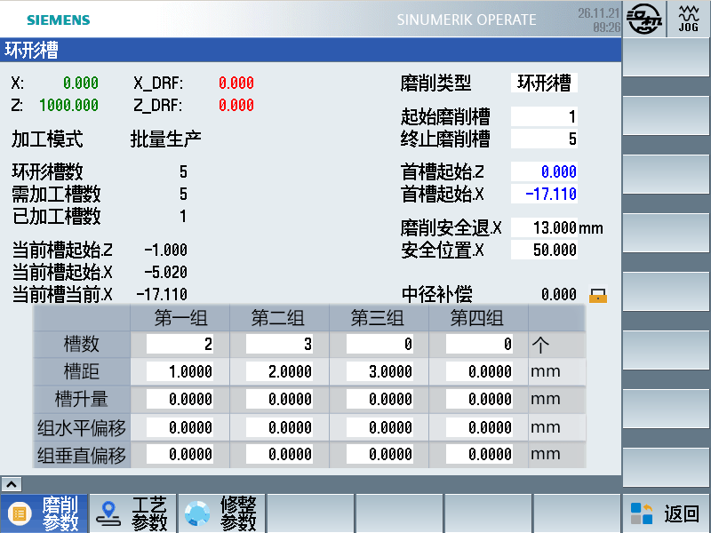
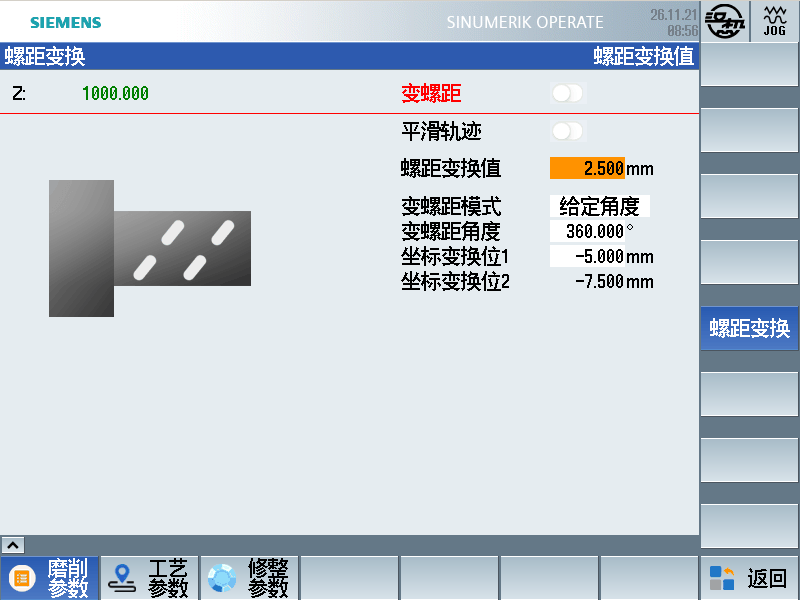
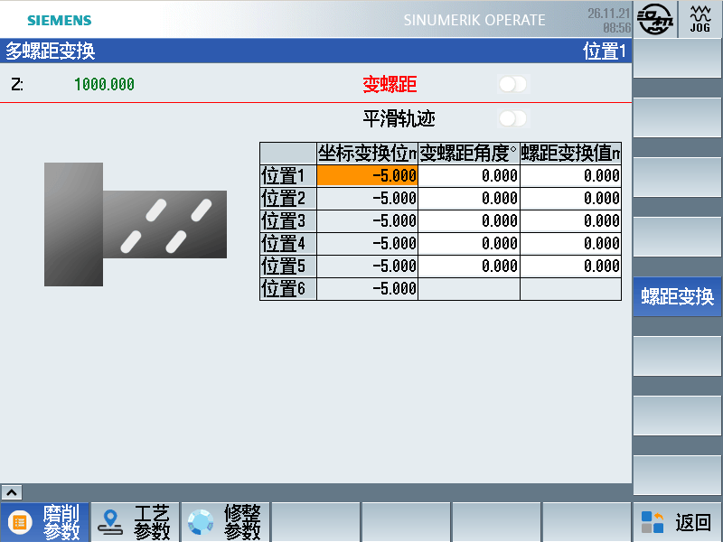
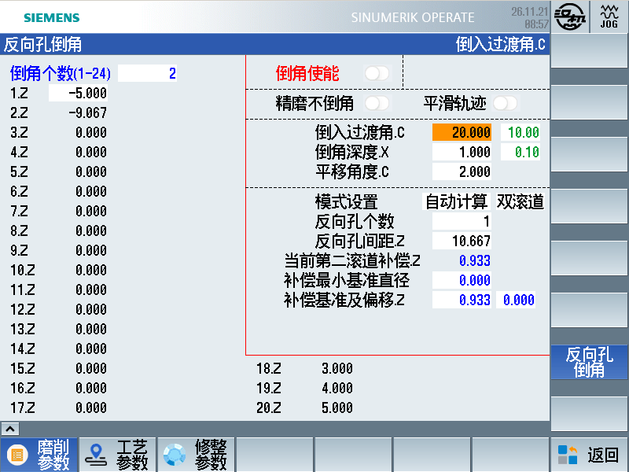
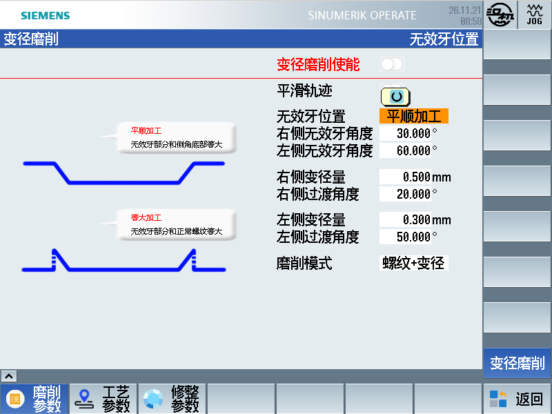
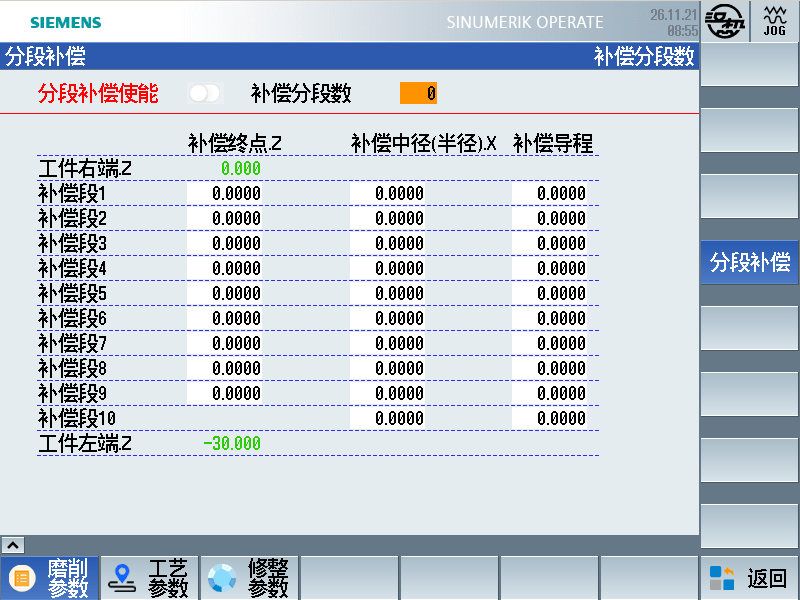
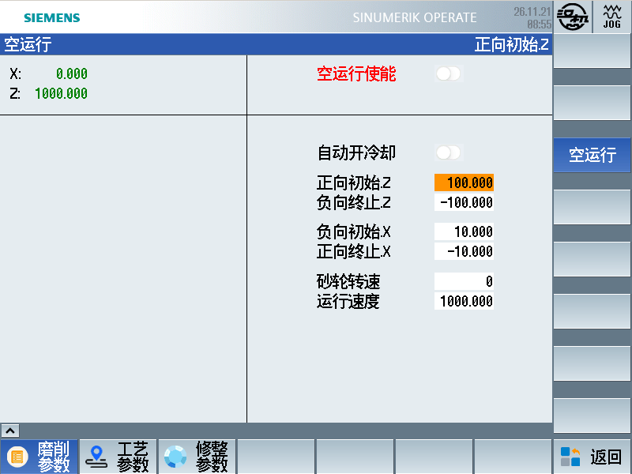
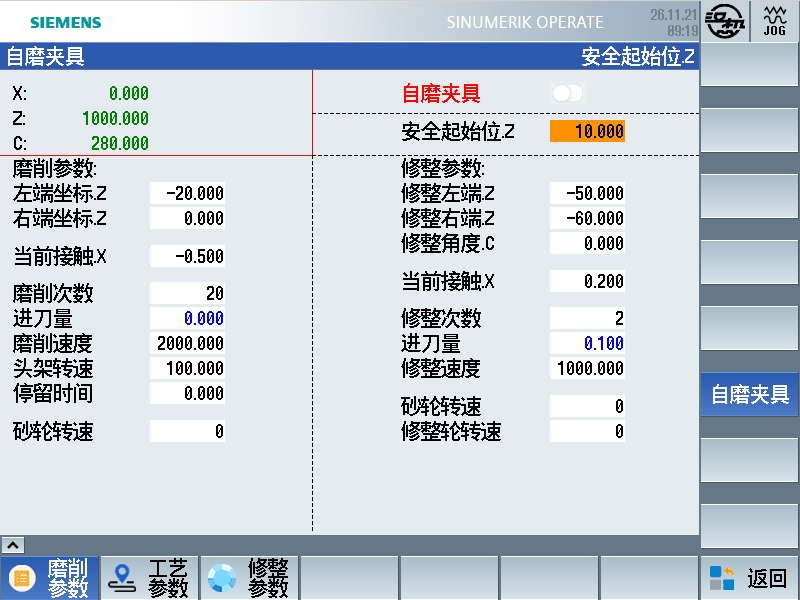

[机床功能介绍](index.html)

---

磨削扩展功能

---

以下功能需在机床配置中开启后，才会在磨削界面右侧出现对应软键；参数说明请参考[磨削界面](section_1.html)

---

环形槽磨削

---

需在机床配置中开启 **环形槽加工** 后才能使用

1. 在磨削界面将 [磨削类型](section_1.html#S1D31) 选为 **环形槽**，自动进入环形槽界面
  
  
  
2. 按图纸填写最多 4 组槽的槽数、槽距、槽升量和组间偏移
3. 将砂轮对准第一个槽，记录 [首槽起始.Z / 首槽起始.X](section_1.html#S1D45)
4. 设置 [起始磨削槽](section_1.html#S1D43) 和 [终止磨削槽](section_1.html#S1D44)，按循环启动逐槽磨削
5. 左侧状态区实时显示已加工槽数和当前槽位置

螺距变换

---

需在机床配置中开启 **螺距变换（单 或 多）** 后才能使用

1. 点击磨削界面右侧 **螺距变换**，打开 [变螺距](section_1.html#S1D60)
  
  
  
2. 输入变换段的螺距变换值，选择变螺距模式（给定角度 / 终点变换）
3. 将砂轮对准螺距开始变化处，记录坐标变换位1；坐标变换位2 自动计算
4. 首次确认位置时关闭平滑轨迹，确认后再打开

中间有多段螺距时，机床配置选择"多"后进入多螺距变换界面，按段填写角度和螺距

反向孔倒角

---

需在机床配置中开启 **反向孔倒角** 后才能使用

1. 点击磨削界面右侧 **反向孔倒角**，打开倒角使能
  
  
  
2. 设置倒入过渡角、倒角深度、平移角度及两端预倒角
3. 选择模式设置：手动输入各倒角 Z 坐标，或输入第一个倒角位置后自动计算
4. 磨削后检查倒角位置与深度，必要时用位置补偿和倒角终点补偿微调

变径磨削

---

需在机床配置中开启 **变径磨削** 后才能使用

1. 点击磨削界面右侧 **变径磨削**，打开变径磨削使能
  
  
  
2. 设置两端无效牙角度、变径量和过渡角度
3. 选择磨削模式：每刀螺纹+变径，或螺纹完成后单独磨变径段

分段补偿

---

需在机床配置中开启 **分段补偿中径/导程** 后才能使用

1. 点击磨削界面右侧 **分段补偿**，打开分段补偿使能并设置分段数
  
  
  
2. 按检测报告从右端起依次输入每段终点 Z 坐标、中径（半径）补偿量和导程补偿量
3. 补偿在自动磨削中生效，手动对刀时不生效；同时打开反向孔倒角、变径磨削或变螺距时不执行分段补偿

空运行热机

---

需在机床配置中开启 **空运行热机** 后才能使用

1. 点击磨削界面右侧 **空运行**，打开空运行使能
  
  
  
2. 设置 Z、X 轴往复范围、砂轮转速和运行速度（确保不碰工件和夹具）
3. 按循环启动，机床空载往复运行进行热机；热机结束后务必关闭空运行使能

自磨夹具

---

需在机床配置中开启 **自磨夹具** 后才能使用

1. 点击磨削界面右侧 **自磨夹具**，打开自磨夹具
  
  
  
2. 设置夹具磨削的左右端、接触位置、次数、进刀量和速度，以及夹具修整参数
3. 按循环启动执行夹具磨削；完成后务必关闭自磨夹具
