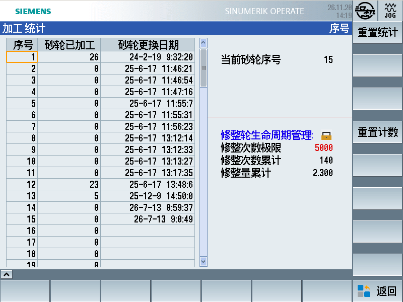
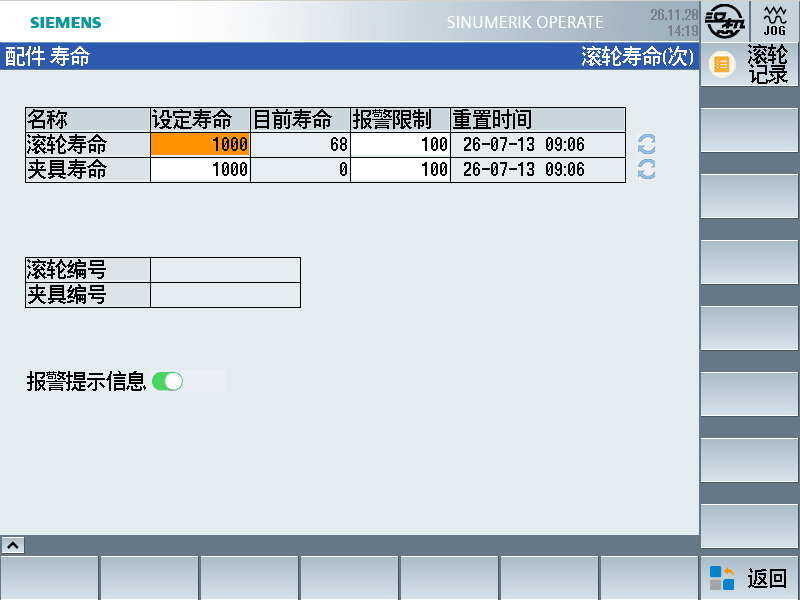
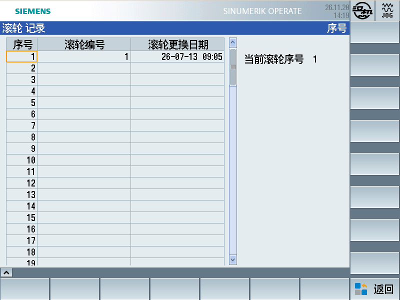

[机床功能介绍](index.html)

---

加工统计与配件寿命

---

具体参数说明请参考[加工统计与配件寿命界面](section_8.html)

---

加工统计

---

需在机床配置中开启 **加工统计** 后欢迎页右侧才显示该软键；修整轮生命周期区还需开启 **修整轮生命周期统计**

1. 在欢迎页右侧点击 **加工统计**（钥匙开关 3 档）
  
  
  
2. 表格按砂轮序号记录每片砂轮加工的工件数和更换日期；更换砂轮并启动新砂轮修整后，自动开始记录下一片（只统计批量生产模式下完成的工件）
3. 修整轮生命周期区显示修整轮已修整次数和累计修整量，达到修整次数极限时提示更换
4. 更换修整轮后点击 **重置计数** 并确认；需要清空全部砂轮记录时点击 **重置统计** 并确认

配件寿命

---

需在机床配置中开启 **配件寿命界面显示** 后欢迎页右侧才显示该软键

1. 在欢迎页右侧点击 **配件寿命**
  
  
  
2. 为每种配件设置设定寿命和报警限制，并打开 **报警提示信息**
3. 机床运行中自动累计目前寿命；超过报警限制后，启动程序时暂停并提示更换
4. 更换配件后点击该行右侧 ↺ 图标，目前寿命清零并记录重置时间
5. 点击右侧 **滚轮记录** 查看历次更换的滚轮编号与日期
  

