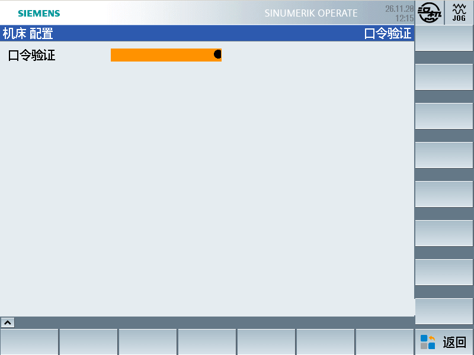

[机床功能介绍](index.html)

---

机床配置管理

---

参数说明请参考[机床配置界面](section_7.html)

---

机床配置界面

---

  

机床配置界面是制造商的配置管理界面，用于设定机床结构、选配功能的开启与隐藏、以及界面参数的输入范围等  
该界面受口令保护：进入时屏幕显示挑战码，需要由制造商根据挑战码提供解锁口令  
**如需访问或修改机床配置，请联系机床制造商**，不要自行修改，错误的配置可能导致机床动作异常

以下情况需要联系制造商处理机床配置：

1. 需要开启或关闭空运行、分段补偿、螺距变换、反向孔倒角、加工统计等选配功能界面
2. 更换系统或重新导入机床程序后需要重置机床数据
3. 需要放宽或收紧中径调整、工艺进给等参数的输入范围
