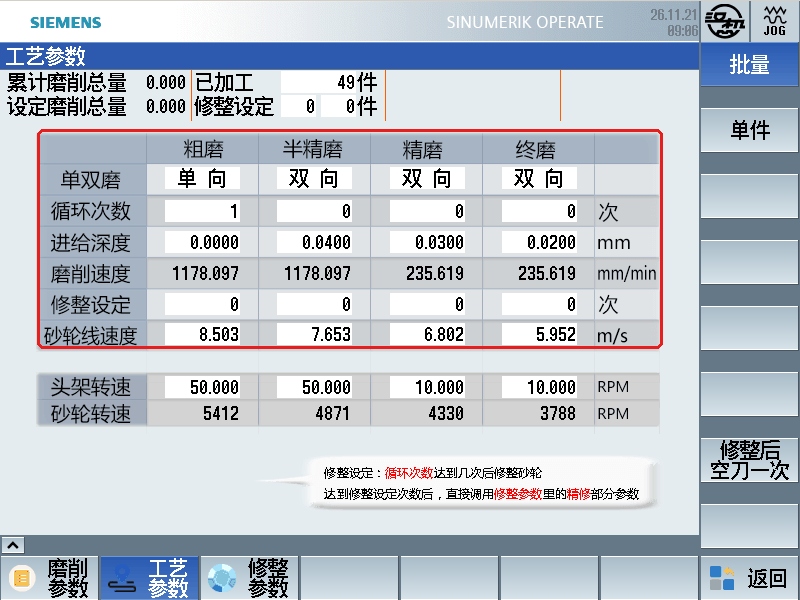
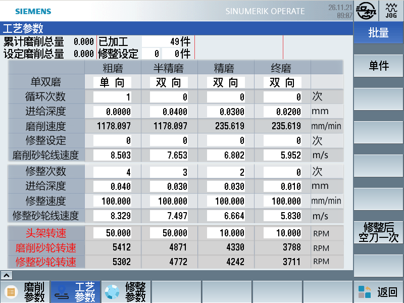
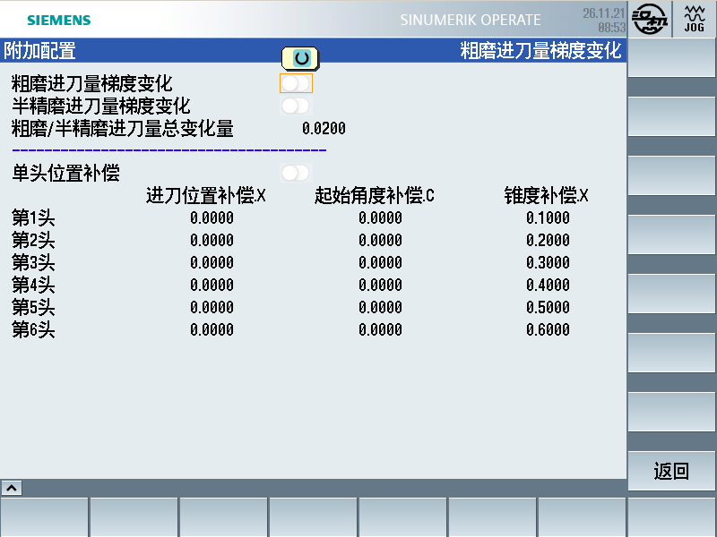
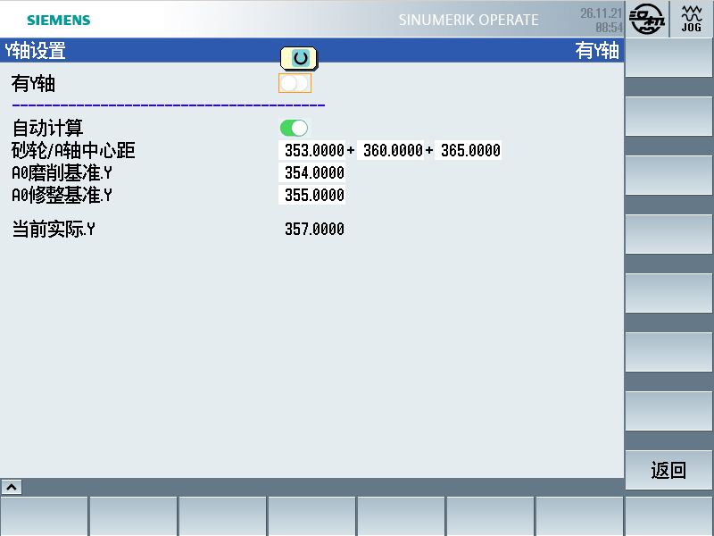

[HMI界面参数定义](index.html)

---

工艺界面

---

具体操作步骤请参考[磨削](section_12.html)  
在用户界面中点击屏幕下方 **工艺参数** 软键进入本页

---

工艺参数表

---

  
红框：各工序（粗磨、半精磨、精磨、终磨）的工艺参数表  

工艺表按列分为 **粗磨 / 半精磨 / 精磨 / 终磨** 四道工序，程序按此顺序依次执行，每道工序按循环次数重复磨削  
右侧 **批量**/**单件**软键切换两套独立的工艺表，分别对应磨削界面加工模式的批量生产与单件调整  
机床配置为扩展工艺时，表中增加每道工序的修整参数（见下方扩展工艺参数）  
工艺模式选择 DIY 时，磨削按用户 DIY 程序执行，工艺表全部只读；程序运行中工艺表同样只读

|  |  |
| --- | --- |
| 单双磨 | 推荐设置：无 |
| 取值范围 | 单向/双向 |

**单向**：只在一个方向磨削，返回时不进刀、不磨削  
**双向**：往返两个方向都磨削，在两端各进刀一次，效率更高  
*修改权限：钥匙开关3档及以上*

|  |  |
| --- | --- |
| 循环次数 | 推荐设置：无 |
| 取值范围 | ≥ 0 |

每道工序的磨削次数，按工艺要求设置；某道工序不需要时设为 0  
*修改权限：钥匙开关3档及以上*

|  |  |
| --- | --- |
| 进给深度 | 推荐设置：0.005~0.05 |
| 取值范围 | 粗磨不限，其余工序默认 ±0.1（限制值可在机床配置中修改）（单位：mm） |

每次循环的 X 向（直径方向半值）进刀量。通常粗磨进刀量最大、逐道工序递减，终磨可设小值或 0 用于光磨  
双向磨削时进刀量的含义由机床配置决定：  
**双向总和**模式：输入值为一个往返的总进刀量  
**单次进刀**模式：输入值为每个方向的进刀量，一个往返实际进刀为输入值的 2 倍  
机床配置开启粗磨自动计算时，粗磨进给深度只读，由设定磨削总量反算  
*修改权限：钥匙开关3档及以上*

|  |  |
| --- | --- |
| 磨削速度 | 推荐设置：无 |
| 取值范围 | 只读（单位：mm/min） |

Z 轴磨削进给速度，由头架转速自动计算：磨削速度 = 头架转速 × 螺距 × 头数  
*界面只读显示，由程序自动写入*

|  |  |
| --- | --- |
| 磨几次修整（修整设定） | 推荐设置：无 |
| 取值范围 | ≥ 0 |

该工序中每磨削几次循环后自动修整一次砂轮，0 表示该工序中不修整  
例：粗磨循环 5 次、设定为 2，则在第 2、4 次循环后修整  
磨削中修整使用修整界面的精修参数（次数/进给量/速度）  
*修改权限：钥匙开关3档及以上*

|  |  |
| --- | --- |
| 砂轮线速度 | 推荐设置：25m/s |
| 取值范围 | 15~50（单位：m/s） |

磨削时砂轮外圆线速度。不同砂轮材质最佳线速度差异较大，CBN 砂轮一般需要较高线速度  
非恒转速模式下输入线速度，界面按当前砂轮直径自动换算砂轮转速：转速 = 线速度 × 60000 / (π × 砂轮直径)  
机床配置开启 **恒转速模式** 后此值只读，由输入的砂轮转速反算  
*修改权限：钥匙开关3档及以上*

|  |  |
| --- | --- |
| 头架转速 | 推荐设置：无 |
| 取值范围 | 默认不超过 60（限制值可在机床配置中修改）（单位：r/min） |

磨削时头架（C 轴）转速，决定磨削速度。转速越高效率越高，但表面质量下降  
一般粗磨用较高转速，精磨、终磨用较低转速  
*修改权限：钥匙开关3档及以上*

|  |  |
| --- | --- |
| 磨削砂轮转速 | 推荐设置：无 |
| 取值范围 | 由线速度换算（单位：r/min） |

非恒转速模式下由线速度和当前砂轮直径自动计算，只读  
机床配置为砂轮恒转速时可直接输入转速，线速度随砂轮直径变化  
*修改权限：钥匙开关3档及以上*

磨削总量与修整计数

---

|  |  |
| --- | --- |
| 设定磨削总量 / 累计磨削总量 | 推荐设置：按工件余量 |
| 取值范围 | 无（单位：mm） |

**设定磨削总量**：一个工件从初始接触.X 起需要磨去的总量，默认按 各工序循环次数 × 进给深度 自动累加计算  
机床配置开启粗磨自动计算时可直接输入总量，粗磨进给深度按 (总量 - 其余工序进刀量) / 粗磨次数 反算  
**累计磨削总量**：当前工件已经实际进刀的总量，只读  
工艺模式为 DIY 时需根据 DIY 程序自行计算  
*修改权限：钥匙开关3档及以上*

|  |  |
| --- | --- |
| 已加工 | 推荐设置：0 |
| 取值范围 | 自动累计（单位：件） |

磨削工件计数，批量模式下每完成一个工件自动加 1，用于按件数自动修整  
可手动清零重新计数  
*修改权限：钥匙开关3档及以上*

|  |  |
| --- | --- |
| 修整设定-大砂轮 | 推荐设置：按工艺要求 |
| 取值范围 | ≥ 0（单位：件） |

砂轮直径大于临界直径时，每加工几件后在下一件开始前自动修整一次砂轮，0 表示不按件数修整  
临界直径由机床配置设定；修整使用修整界面的精修参数  
*修改权限：钥匙开关3档及以上*

|  |  |
| --- | --- |
| 修整设定-小砂轮 | 推荐设置：按工艺要求 |
| 取值范围 | ≥ 0（单位：件） |

砂轮直径小于等于临界直径时的按件数修整间隔。小砂轮磨损快，通常设置比大砂轮更小的间隔  
*修改权限：钥匙开关3档及以上*

|  |  |
| --- | --- |
| 修整模式 | 推荐设置：无 |
| 取值范围 | 次数/头数 |

多头螺纹磨削中修整的计数方式（需在机床配置中开启）  
**次数**：所有头磨完算一次循环计数  
**头数**：每磨完一个头计数一次，修整更频繁  
*修改权限：钥匙开关3档及以上*

|  |  |
| --- | --- |
| 修整后空刀一次 | 推荐设置：无 |
| 取值范围 | 开/关（右侧软键点亮为开） |

右侧 **修整后空刀一次** 软键点亮时，磨削中每次修整砂轮后，下一次循环不进刀先磨一刀，消除修整误差；按头数修整时无效

|  |  |
| --- | --- |
| 起始工序选择 / 起始循环选择 | 推荐设置：无 |
| 取值范围 | 粗磨/半精磨/精磨/终磨；循环号 |

批量磨削时从指定工序的指定循环开始加工（需在机床配置中开启），之前工序的进刀量自动累加到当前接触位置  
用于加工中断后从断点继续，起始循环大于本工序循环次数时直接进入下一工序  
右上角同时显示当前正在加工的工序

|  |  |
| --- | --- |
| 工艺模式 | 推荐设置：无 |
| 取值范围 | 界面工艺/DIY |

**界面工艺**：按本页工艺表磨削  
**DIY**：按用户编写的 DIY 加工程序磨削，工艺表只读；DIY 时设定磨削总量需根据程序自行计算  
*修改权限：钥匙开关3档及以上*

|  |  |
| --- | --- |
| 工艺类型 | 推荐设置：无 |
| 取值范围 | 标准工艺/扩展工艺 |

显示当前为标准工艺表还是扩展工艺表（带各工序修整参数），由机床配置决定  
*修改权限：钥匙开关3档及以上*

扩展工艺参数

---

  

机床配置为扩展工艺时，工艺表中每道工序增加独立的修整参数，磨削中修整按当前工序参数执行，不再统一使用修整界面精修参数

|  |  |
| --- | --- |
| 修整次数 | 推荐设置：无 |
| 取值范围 | ≥ 0 |

该工序中每次修整时修整器往复修整的次数  
*修改权限：钥匙开关3档及以上*

|  |  |
| --- | --- |
| 修整进给深度 | 推荐设置：无 |
| 取值范围 | ≥ 0（单位：mm） |

该工序中每次修整的进给量（直径方向半值），砂轮直径与磨削位置按此自动补偿  
*修改权限：钥匙开关3档及以上*

|  |  |
| --- | --- |
| 修整速度 | 推荐设置：无 |
| 取值范围 | 大于 0（单位：mm/min） |

该工序修整时修整轴沿齿形运动的速度  
*修改权限：钥匙开关3档及以上*

|  |  |
| --- | --- |
| 修整砂轮线速度 / 修整砂轮转速 | 推荐设置：无 |
| 取值范围 | 线速度 ≥ 0 |

该工序修整时砂轮线速度（m/s），修整砂轮转速按当前砂轮直径自动换算并只读显示  
机床配置开启 **恒转速模式** 后改为直接输入修整砂轮转速，线速度只读显示  
*修改权限：钥匙开关3档及以上*

三线测量与压力显示

---

|  |  |
| --- | --- |
| 工件外径 / 三线测量 / 钢球直径 / 终尺寸H | 推荐设置：无 |
| 取值范围 | 无（单位：mm） |

机床配置开启三线测量显示后出现，用于现场换算测量结果  
输入工件外径、三线（量棒）测量值和钢球直径，界面自动计算 终尺寸H = (工件外径 - 三线测量) / 2 + 钢球直径

|  |  |
| --- | --- |
| 头架压力 / 系统压力 | 推荐设置：无 |
| 取值范围 | 只读 |

机床配置开启压力检测显示后出现，实时显示头架和液压系统压力，用于监控夹紧状态  
*界面只读显示，由程序自动写入*

附加配置界面

---

  

在机床配置中开启后，工艺界面右侧出现 **附加配置** 软键

|  |  |
| --- | --- |
| 粗磨/半精磨进刀量梯度变化 | 推荐设置：无 |
| 取值范围 | 关/开 |

打开后粗磨（或半精磨）每次进刀量不再相同，而是从大到小线性递减，总进刀量不变，减小后期磨削力  
*修改权限：钥匙开关3档及以上*

|  |  |
| --- | --- |
| 粗磨/半精磨进刀量总变化量 | 推荐设置：无 |
| 取值范围 | -1~1（单位：mm） |

梯度变化时第一刀与最后一刀进刀量的差值；总变化量大于设定进刀量的两倍时不执行梯度进刀  
*修改权限：钥匙开关3档及以上*

|  |  |
| --- | --- |
| 单头位置补偿 | 推荐设置：无 |
| 取值范围 | 关/开 |

多头螺纹各头之间存在尺寸或位置差异时打开，按下方表格对第 1~6 头分别补偿  
*修改权限：钥匙开关3档及以上*

|  |  |
| --- | --- |
| 第1头~第6头补偿（进刀.X / 角度.C / 锥度.X） | 推荐设置：无 |
| 取值范围 | -1~1 |

**进刀.X**：该头磨削起始 X 位置补偿（mm），用于修正各头中径差  
**角度.C**：该头分度角补偿（°），用于修正各头等分误差  
**锥度.X**：该头全长锥度补偿（mm），用于修正各头锥度差异  
*修改权限：钥匙开关3档及以上*

Y轴设置界面

---

  

用于带 Y 轴的机床（砂轮架可沿 Y 向移动），在机床配置中开启后工艺界面右侧出现 **Y轴设置** 软键  
A 轴摆动螺旋升角后砂轮中心会偏离，程序按中心距自动计算 Y 轴补偿位置，使磨削点与修整点保持在中心

|  |  |
| --- | --- |
| 有Y轴 | 推荐设置：无 |
| 取值范围 | 关/开 |

打开后磨削和修整时 Y 轴自动移动到计算位置  
*修改权限：钥匙开关3档及以上*

|  |  |
| --- | --- |
| 自动计算 | 推荐设置：无 |
| 取值范围 | 关/开 |

**开**：按砂轮/A轴中心距和 A0 基准位置自动计算磨削实际.Y、修整实际.Y  
**关**：磨削实际.Y 与修整实际.Y 手动输入  
*修改权限：钥匙开关3档及以上*

|  |  |
| --- | --- |
| 砂轮/A轴中心距 | 推荐设置：无 |
| 取值范围 | 无（单位：mm） |

依次为电主轴端面到 A 轴回转中心距离（砂轮在 A 左侧为正）、磨杆长度、砂轮修整中心到磨杆端面距离，用于自动计算  
*修改权限：钥匙开关3档及以上*

|  |  |
| --- | --- |
| A0磨削基准.Y / A0修整基准.Y | 推荐设置：无 |
| 取值范围 | 无（单位：mm） |

A 轴为 0° 时砂轮对准工件中心和修整器中心的 Y 坐标  
*修改权限：钥匙开关3档及以上*

|  |  |
| --- | --- |
| 磨削实际.Y（当前实际.Y） / 修整实际.Y | 推荐设置：无 |
| 取值范围 | 无（单位：mm） |

磨削和修整时 Y 轴实际运动到的位置；自动计算开启时只读显示计算结果  
*修改权限：钥匙开关3档及以上*
