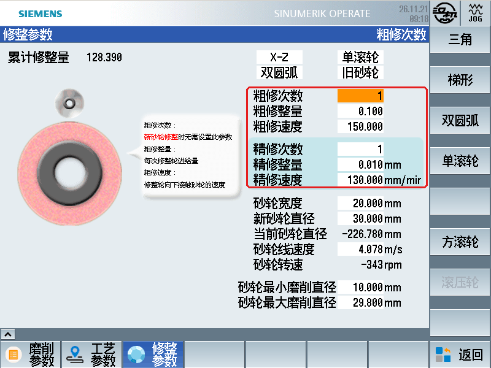

[HMI界面参数定义](index.html)

---

修整界面

---

具体操作步骤请参考[砂轮修整](section_10.html)  
在用户界面中点击屏幕下方 **修整参数** 软键进入本页；右侧软键进入齿形与修整轮参数页面

---

修整主界面

---

  
红框：单独修整时使用的粗修、精修参数  

修整有两种触发方式：  
**单独修整**：点亮机床操作面板上的修整键后启动程序，按本页的粗修、精修参数修整砂轮，不磨削工件  
**磨削中修整**：磨削过程中按工艺界面的修整设定自动修整，只执行精修部分（扩展工艺时使用工艺表中各工序的修整参数）  
每次修整后砂轮直径自动减小，磨削位置按修整量自动补偿，无需重新对刀

|  |  |
| --- | --- |
| 修整器类型 | 推荐设置：无 |
| 取值范围 | X-W/成型X |

**X-W**（插补修整）：使用碟形修整轮，修整器两轴联动沿齿形轮廓逐点修整  
**成型X**（成型修整）：使用成型滚压轮，X 轴直线进给把滚轮齿形复制到砂轮上  
按机床实际安装的修整轮选择，切换后到右侧对应的齿形或滚轮页面设置参数  
*修改权限：钥匙开关3档及以上*

|  |  |
| --- | --- |
| 修整轮类型 | 推荐设置：无 |
| 取值范围 | 单滚轮/方滚轮 |

按修整器上实际安装的修整轮选择：  
**单滚轮**：圆弧刃口碟形轮，可修出带圆弧的齿根  
**方滚轮**：平刃方形轮，需要输入滚轮厚度和左右圆弧  
切换后点击右侧对应软键设置修整中心距等滚轮参数  
*修改权限：钥匙开关3档及以上*

|  |  |
| --- | --- |
| 修整轮类型（成型修整） | 推荐设置：无 |
| 取值范围 | 滚压轮（固定） |

修整器类型选为成型修整时，修整轮类型固定显示 **滚压轮**；滚压轮齿形与工件齿形一致，修整时直接复制到砂轮上  
滚压轮参数在右侧 **滚压轮** 页面设置  
*界面只读显示，由程序自动写入*

|  |  |
| --- | --- |
| 齿形 | 推荐设置：无 |
| 取值范围 | 三角/梯形/双圆弧（开放附加齿形后还有行星齿、平面） |

选择插补修整要修出的砂轮齿形，切换后点击右侧对应的齿形软键设置齿形参数  
成型修整时齿形由滚轮决定，此项不起作用  
*修改权限：钥匙开关3档及以上*

|  |  |
| --- | --- |
| 平面锥度 | 推荐设置：无 |
| 取值范围 | 无（单位：mm） |

齿形选择 **平面** 时可用，用于把砂轮修成平面（如内孔磨砂轮）  
输入值为砂轮宽度范围内两侧的直径差，正值修整后砂轮左大右小，0 为圆柱面  
*修改权限：钥匙开关3档及以上*

|  |  |
| --- | --- |
| 砂轮状态 | 推荐设置：无 |
| 取值范围 | 新砂轮/旧砂轮 |

更换新砂轮后切换为 **新砂轮**，并输入正确的新砂轮直径和修整轮参数，然后执行一次单独修整  
新砂轮修整时从砂轮外圆开始逐层修出完整齿形；修整第一刀后即自动切换为旧砂轮，中途停止后再次启动按旧砂轮继续修整  

内螺纹新砂轮修整时，程序按 (新砂轮直径 - 砂轮最大磨削直径) / 2 和粗修、精修整量自动计算粗修与精修次数（最后约 5 次为精修），直接修到砂轮最大磨削直径；界面上的粗修、精修次数此时不起作用

|  |  |
| --- | --- |
| 新砂轮是否是成型砂轮 | 推荐设置：无 |
| 取值范围 | 普通/成型 |

需在机床配置中开启后显示  
**普通**：砂轮外圆为平的，新砂轮修整时先抬刀，从齿顶逐层向下修出齿形  
**成型**：砂轮已预先做出齿形，新砂轮修整时不抬刀，直接按齿形修整  
*修改权限：钥匙开关3档及以上*

|  |  |
| --- | --- |
| 修整角度 | 推荐设置：0 |
| 取值范围 | -90~90（单位：°） |

带 A 轴的机床修整时砂轮架摆动到的角度，默认 0° 修整  
需要避让干涉或微调修整出的齿形角度时设置（需在机床配置中开启显示）  
*修改权限：钥匙开关3档及以上*

修整次数与修整量

---

|  |  |
| --- | --- |
| 粗修次数 | 推荐设置：无 |
| 取值范围 | 0~1000 |

单独修整时先执行的粗修次数。粗修用较大修整量快速修出齿形  
磨削中修整不执行粗修

|  |  |
| --- | --- |
| 粗修整量 | 推荐设置：无 |
| 取值范围 | 0~0.5（单位：mm） |

粗修时每次修整的进给量（半径方向）  
*修改权限：钥匙开关3档及以上*

|  |  |
| --- | --- |
| 粗修速度 | 推荐设置：无 |
| 取值范围 | 0~1000（单位：mm/min） |

粗修时修整轮沿砂轮齿形运动的速度  
*修改权限：钥匙开关3档及以上*

|  |  |
| --- | --- |
| 精修次数 | 推荐设置：无 |
| 取值范围 | 0~1000 |

单独修整时粗修之后执行的精修次数；磨削中修整也按此次数修整  
*修改权限：钥匙开关3档及以上*

|  |  |
| --- | --- |
| 精修整量 | 推荐设置：0.005~0.02 |
| 取值范围 | 0~0.1（限制值可在机床配置中修改）（单位：mm） |

精修时每次修整的进给量（半径方向），决定砂轮齿形的最终质量  
*修改权限：钥匙开关3档及以上*

|  |  |
| --- | --- |
| 精修速度 | 推荐设置：无 |
| 取值范围 | 0~1000（单位：mm/min） |

精修时修整轮的运动速度，速度越低砂轮表面越细  
*修改权限：钥匙开关3档及以上*

|  |  |
| --- | --- |
| 新砂轮轮廓修整量 | 推荐设置：无 |
| 取值范围 | 0~5（单位：mm） |

粗修整量右侧的小框（需在机床配置中开启）。新砂轮修整时，砂轮外轮廓部分单独使用的每次修整量  
未开启时轮廓部分使用粗修整量（无粗修时使用精修整量）  
*修改权限：钥匙开关3档及以上*

|  |  |
| --- | --- |
| 新砂轮轮廓修整速度 | 推荐设置：无 |
| 取值范围 | 0~1000（单位：mm/min） |

粗修速度右侧的小框。新砂轮修整时砂轮外轮廓部分单独使用的修整速度  
需在机床配置中开启 **新砂轮轮廓部分单独修整参数** 后显示  
*修改权限：钥匙开关3档及以上*

|  |  |
| --- | --- |
| 累计修整量 | 推荐设置：无 |
| 取值范围 | 只读（单位：mm） |

从新砂轮开始累计修掉的量，等于 (新砂轮直径 - 当前砂轮直径) / 2  
*界面只读显示，由程序自动写入*

|  |  |
| --- | --- |
| 磨削中补偿 | 推荐设置：无 |
| 取值范围 | -0.5~0.5（单位：mm） |

需在机床配置中开启显示。磨削中修整时，每精修一次，额外对磨削位置（初始接触.X 和当前接触.X）补偿的量；例如一次修整精修 2 次，则补偿 2 倍此值  
批量加工中工件尺寸随修整持续向一个方向变化时使用；正值使磨削位置沿 X 轴正方向偏移（外螺纹为少磨、工件尺寸变大）  
单独修整（点亮修整键）时不补偿  
*修改权限：钥匙开关3档及以上*

|  |  |
| --- | --- |
| 补偿累计 | 推荐设置：无 |
| 取值范围 | 只读（单位：mm） |

磨削中补偿已经累计到磨削位置上的总量  
新砂轮修整时，程序先从磨削位置中扣除这部分累计量再清零；首件工件手动对刀后也会清零  
需在机床配置中开启 **修整后磨削位补偿参数显示** 后显示  
*界面只读显示，由程序自动写入*

砂轮参数

---

|  |  |
| --- | --- |
| 砂轮宽度 | 推荐设置：实测 |
| 取值范围 | 0~200（单位：mm） |

当前砂轮的实际宽度，插补修整时用于计算修整轨迹，需用量具测量后输入

|  |  |
| --- | --- |
| 新砂轮直径 | 推荐设置：实测 |
| 取值范围 | 0~1000（单位：mm） |

更换新砂轮后测量砂轮外径输入（可比实测值大 0.2mm 左右，保证首次修整能完整修出外圆）

|  |  |
| --- | --- |
| 当前砂轮直径 | 推荐设置：无 |
| 取值范围 | 只读（单位：mm） |

程序按每次修整量自动计算的当前砂轮直径，用于线速度换算和直径报警  
*界面只读显示，由程序自动写入*

|  |  |
| --- | --- |
| 砂轮线速度 | 推荐设置：22m/s 左右 |
| 取值范围 | 0~80（单位：m/s） |

修整时砂轮外圆线速度。非恒转速模式下输入线速度，砂轮转速按当前直径自动换算  
通常 22m/s 左右，可根据砂轮大小与材质适当调整  
机床配置开启 **恒转速模式** 后改为直接输入砂轮转速，线速度只读显示  
*修改权限：钥匙开关3档及以上*

|  |  |
| --- | --- |
| 砂轮转速 | 推荐设置：无 |
| 取值范围 | 只读或按配置输入（单位：rpm） |

修整时砂轮转速，转速 = 线速度 × 60000 / (π × 当前砂轮直径)  
机床配置为砂轮恒转速时直接输入转速，线速度只读  
*修改权限：钥匙开关3档及以上*

|  |  |
| --- | --- |
| 砂轮最小磨削直径 | 推荐设置：按砂轮法兰或磨杆尺寸 |
| 取值范围 | 0~1000（单位：mm） |

砂轮允许使用到的最小直径。当前砂轮直径小于此值时机床报警，需更换砂轮  

按 (工件小径 + 牙高 × 2) 再适当放大设置  

*修改权限：钥匙开关3档及以上*

|  |  |
| --- | --- |
| 砂轮最大磨削直径 | 推荐设置：砂轮能进入工件内孔的直径 |
| 取值范围 | 0~1000，且至少比新砂轮直径小 0.2（单位：mm） |

新砂轮修整时自动修整到此直径，保证砂轮能进入工件内孔  
当前砂轮直径大于此值时启动磨削程序会报警  
*修改权限：钥匙开关3档及以上*

外部齿形与蜗杆齿形

---

|  |  |
| --- | --- |
| 齿型调用选择 | 推荐设置：无 |
| 取值范围 | 内部集成/外部模式1/外部模式2 |

需在机床配置中开启外部齿形程序后显示  
**内部集成**：使用系统内置的齿形（三角、梯形、双圆弧等）  
**外部模式1**：调用外部齿形程序，左右齿面分开修整  
**外部模式2**：调用外部齿形程序，带刀具半径补偿的连续轨迹  
*修改权限：钥匙开关3档及以上*

|  |  |
| --- | --- |
| 外部程序路径 / 外部程序目录 / 外部齿型程序名 | 推荐设置：无 |
| 取值范围 | 内部SPF/后USB/前USB/CF卡 |

选择外部齿形程序存放的位置、文件夹和程序名称  
使用后部 USB 时需要先在系统逻辑驱动器中配置好，名称设为 //DEV\_3  
*修改权限：钥匙开关3档及以上*

|  |  |
| --- | --- |
| 齿高 / 抬刀 | 推荐设置：无 |
| 取值范围 | 0~50（单位：mm） |

外部模式2 连续轨迹齿形的齿高，以及修整起点前的抬刀高度  
*修改权限：钥匙开关3档及以上*
