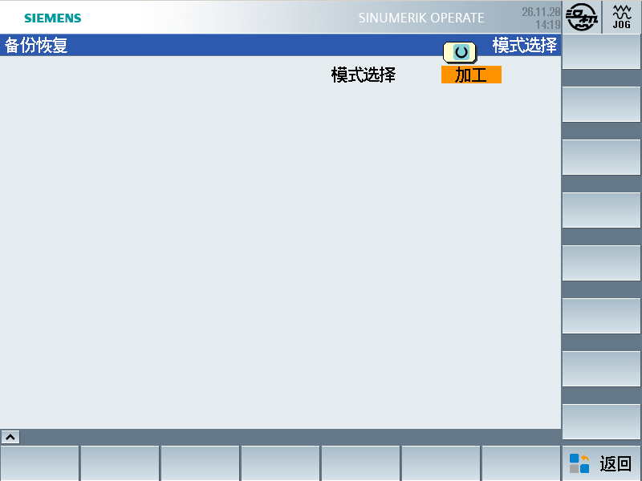

[机床功能介绍](index.html)

---

参数备份恢复

---

具体参数设置请参考[参数备份恢复界面](section_31.html)  
在欢迎页右侧点击 **备份恢复** 进入（需用户口令，机床配置中开启后显示）

---

正常加工

---

1. 备份恢复界面的 **模式选择** 必须设置为 **加工**，机床才执行正常的磨削程序
  

备份参数

---

1. 打开备份恢复界面，将模式选择设为 **备份**
2. 设置备份路径、备份目录和文件名称
3. 根据需要选择备份模式（全部参数或自定义变量列表）
4. 自定义变量模式还需定义列表目录、列表名称和列表行数
5. 按循环启动执行备份，完成后将模式选择改回 **加工**

恢复参数

---

1. 打开备份恢复界面，将模式选择设为 **恢复**
2. 设置恢复路径、恢复目录和文件名称
3. 按循环启动执行恢复，完成后将模式选择改回 **加工**

恢复存放在后部 USB 的文件时，需要先在系统逻辑驱动器中配置好，名称设为 //DEV\_3

自定义备份变量列表

---

变量列表文件存放在系统子程序目录下，规则如下：  
参数最多 790 个  
需要在界面中填写文件总行数（包括注释行和空行）  
以分号 ; 开头的行为注释，不会被读取；空行也不会被读取  
参数名前加星号 \* 表示字符串变量

示例文件 PAR\_DEMO.TXT 共 14 行（含注释行和空行），列表行数应填写 14：

| 行号 | 文件内容 | 说明 |
| --- | --- | --- |
| 1 | ;PAR\_DEMO.TXT | 注释，不读取 |
| 2 |  | 空行，不读取 |
| 3 | ;此文件为示例参数列表文件 | 注释，不读取 |
| 4 | ;需要在行数参数中声明此文件总共有多少行 | 注释，不读取 |
| 5 | ;行开头用分号定义注释，注释行和空行不会被读取 | 注释，不读取 |
| 6 | ;参数名称前加星号表示字符串变量 | 注释，不读取 |
| 7 |  | 空行，不读取 |
| 8 | R0 | 备份 R0 |
| 9 | R1 | 备份 R1 |
| 10 |  | 空行，不读取 |
| 11 | R2 | 备份 R2 |
| 12 | \*STRING | 备份字符串变量 STRING |
| 13 | ;注释行 | 注释，不读取 |
| 14 | R3 | 备份 R3 |
