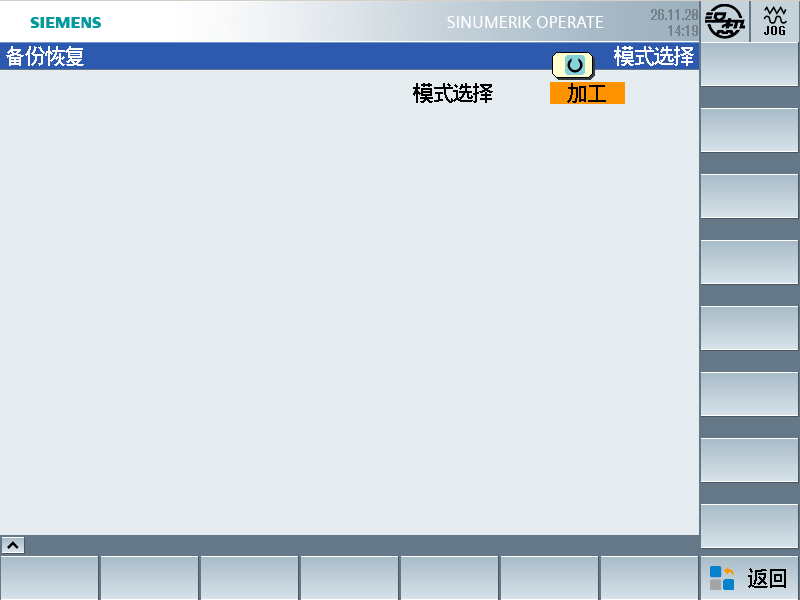

[HMI界面参数定义](index.html)

---

参数备份恢复界面

---

具体操作步骤请参考[参数备份恢复](section_30.html)  
在欢迎页右侧点击 **备份恢复** 软键进入（需用户口令级别，机床配置中开启后显示）

---

参数备份恢复界面

---

需在机床配置中开启 **参数备份恢复** 后，欢迎页右侧才显示 **备份恢复** 软键

  

|  |  |
| --- | --- |
| 模式选择 | 推荐设置：无 |
| 取值范围 | 加工/备份/恢复 |

**加工**：按循环启动执行正常的磨削程序  
**备份** / **恢复**：按循环启动执行参数备份或恢复，不进行磨削  
备份恢复完成后必须切换回 **加工**，否则机床不能正常加工

|  |  |
| --- | --- |
| 备份路径 | 推荐设置：无 |
| 取值范围 | 内部SPF/前USB/CF卡 |

设置需要将备份文件存储在哪个位置  
如需备份到前置 USB，需要将配置文件 **extdev.ini** 放入系统目录 **/oem/sinumerik/nck**（或 user 下对应目录），并重启系统。后置 USB 只能用于恢复，不能用于备份

|  |  |
| --- | --- |
| 备份目录 | 推荐设置：无 |
| 取值范围 | 备份文件夹名称 |

如果文件夹不存在会自动创建

|  |  |
| --- | --- |
| 文件名称 | 推荐设置：无 |
| 取值范围 | 备份文件名称 |

备份文件会存储在备份文件夹内，如果文件不存在会自动创建

|  |  |
| --- | --- |
| 备份模式 | 推荐设置：无 |
| 取值范围 | 所有变量/自定义变量 |

设置备份所有全局变量或者指定备份某些变量  
指定自定义备份变量需要额外定义：列表目录、列表名称、列表行数  
具体列表规则参考[参数备份恢复](section_30.html)

|  |  |
| --- | --- |
| 列表目录 | 推荐设置：无 |
| 取值范围 | 自定义变量备份表所在文件夹 |

此文件夹需要定义在系统子程序路径下  
具体列表规则参考[参数备份恢复](section_30.html)

|  |  |
| --- | --- |
| 列表名称 | 推荐设置：无 |
| 取值范围 | 自定义变量备份表名称 |

默认为txt文档，无需写后缀  
具体列表规则参考[参数备份恢复](section_30.html)

|  |  |
| --- | --- |
| 列表行数 | 推荐设置：无 |
| 取值范围 | 0-800 |

设置自定义变量列表文件总行数  
系统会根据此处设置的行数，逐行读取自定义列表内的变量  
具体列表规则参考[参数备份恢复](section_30.html)

|  |  |
| --- | --- |
| 恢复路径 | 推荐设置：无 |
| 取值范围 | 内部SPF/后USB/前USB/CF卡 |

设置需要恢复的变量备份文件存储在哪个位置  
如需恢复存储在后置USB的文件，需要在逻辑驱动器中配置好，名称设置为：**//DEV\_3**

|  |  |
| --- | --- |
| 恢复目录 | 推荐设置：无 |
| 取值范围 | 恢复文件夹名称 |

读取需要恢复的备份文件所在的文件夹

|  |  |
| --- | --- |
| 文件名称 | 推荐设置：无 |
| 取值范围 | 恢复文件名称 |

恢复文件存储在恢复文件夹内
