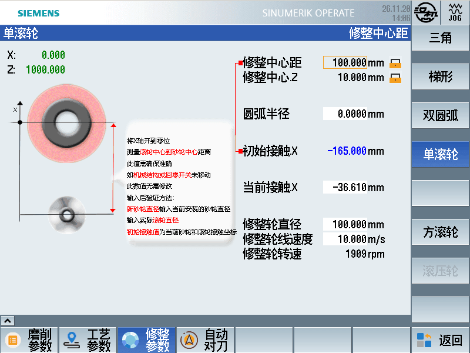
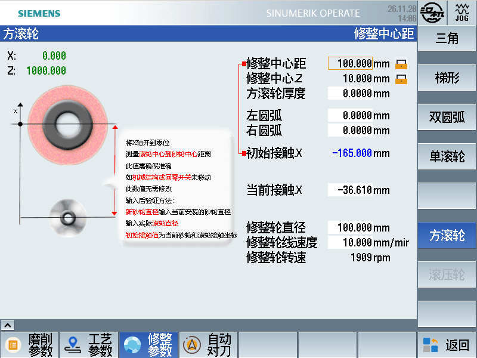
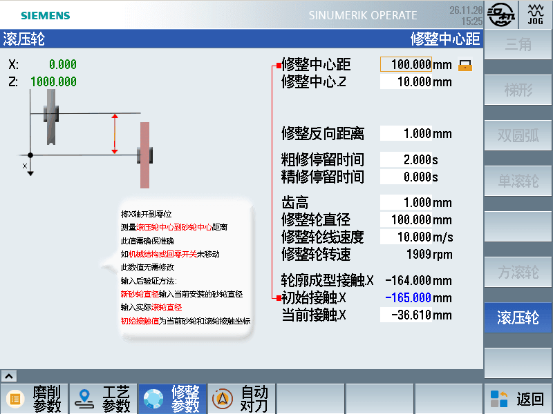

[HMI界面参数定义](index.html)

---

滚轮界面

---

具体操作步骤请参考[砂轮修整](section_10.html)  
在修整界面点击右侧 **单滚轮 / 方滚轮 / 双滚轮 / 滚压轮** 软键进入对应修整轮的参数页面（只显示本机配置的修整轮）

---

修整轮位置标定（通用）

---

修整前必须让程序知道修整轮与砂轮的相对位置，涉及两个参数：  
**修整中心距**（前后方向）：砂轮中心与修整轮中心之间的距离，决定修整从哪里开始进给  
**修整中心**（左右方向）：修整轮对准砂轮宽度中心时修整轴的坐标，决定修出的齿形是否居中  
两个参数旁边的锁形图标默认锁定，需先点击解锁才能修改，防止误改

|  |  |
| --- | --- |
| 修整中心距 | 推荐设置：按测量计算 |
| 取值范围 | -800~800（单位：mm） |

砂轮中心与修整轮中心重合方向上的距离，影响修整的前后起始位置  
计算方法：  
1. 安装新砂轮，测量砂轮直径 D1，输入到修整界面 **新砂轮直径**  
2. 按滚轮图纸输入 **修整轮直径** D2  
3. 移动机床使砂轮外圆刚好接触修整轮外沿，记录当前 X 坐标 X1，输入到 **当前接触.X**  

4. 修整中心距 = |X1 + D1/2 + D2/2|  

设置后查看 **初始接触.X** 是否等于刚才输入的当前接触.X，相等即说明设置正确  
*修改权限：钥匙开关3档及以上*

|  |  |
| --- | --- |
| 修整中心.W | 推荐设置：按测量计算 |
| 取值范围 | -2000~2000（单位：mm） |

修整轮（单滚轮为圆弧圆心）对准砂轮宽度中心时修整器水平轴的坐标，影响修出齿形的左右位置  
测量方法：用修整轮左右侧面分别轻触砂轮左右端面，记录两个坐标 Z1、Z2，修整中心 = (Z1 + Z2) / 2  
双滚轮时为两滚轮间距中心对准砂轮中心时的坐标  
*修改权限：钥匙开关3档及以上*

|  |  |
| --- | --- |
| 参数锁定开关 | 推荐设置：无 |
| 取值范围 | 打开/闭合 |

修整中心距、修整中心旁的锁形图标。默认闭合（只读），点击打开后才能修改  
*修改权限：钥匙开关3档及以上*

单滚轮 / 方滚轮 / 双滚轮（插补修整）

---

  

插补修整轮参数

---

插补修整时修整轮沿齿形轮廓运动，需要准确输入修整轮的几何尺寸

|  |  |
| --- | --- |
| 圆弧半径 / 左圆弧 / 右圆弧 | 推荐设置：按滚轮图纸 |
| 取值范围 | 0~10（单位：mm） |

修整轮刃口的圆弧半径，单滚轮输入一个半径，方滚轮和双滚轮分别输入左、右刃口圆弧  
此值直接影响修出的齿形，须按滚轮图纸或实测输入  
*修改权限：钥匙开关3档及以上*

|  |  |
| --- | --- |
| 方滚轮厚度 | 推荐设置：按滚轮图纸 |
| 取值范围 | 0~100（单位：mm） |

方滚轮刃口的宽度，影响修出齿形的宽度  
*修改权限：钥匙开关3档及以上*

|  |  |
| --- | --- |
| 初始接触.X（初始左端/右端接触） | 推荐设置：无 |
| 取值范围 | 自动计算（单位：mm） |

新砂轮时修整轮接触砂轮外圆的 X 坐标，设置正确的修整中心距后自动计算  
可用于核对修整中心距是否正确  
*修改权限：钥匙开关3档及以上*

|  |  |
| --- | --- |
| 当前接触.X（当前左端/右端接触） | 推荐设置：无 |
| 取值范围 | 自动更新（单位：mm） |

当前砂轮与修整轮接触时的 X 坐标，每次修整后自动更新；旧砂轮修整从此位置开始  
标定修整中心距时，把实测接触坐标输入到这里  
*修改权限：钥匙开关3档及以上*

滚压轮（成型修整）

---

  

成型修整时滚压轮直线进给到砂轮上，把滚轮齿形复制到砂轮，不需要设置齿形参数

|  |  |
| --- | --- |
| 齿高 | 推荐设置：按滚轮图纸 |
| 取值范围 | 0~50（单位：mm） |

滚压轮的齿高，新砂轮修整时程序按此判断砂轮外形是否已全部修出  
*修改权限：钥匙开关3档及以上*

|  |  |
| --- | --- |
| 粗修停留时间 / 精修停留时间 | 推荐设置：1s 左右 |
| 取值范围 | 0~80（单位：s） |

滚压轮每次进给到位后在砂轮上保持接触的时间，使齿形充分成型；精修可适当延长  
*修改权限：钥匙开关3档及以上*

|  |  |
| --- | --- |
| 修整反向距离 | 推荐设置：0 |
| 取值范围 | 0~1（单位：mm） |

滚压轮每次进给到位并停留后，修整轮向后回退的距离，使滚轮与砂轮脱开后再进行下一次进给  
设为 0 时滚轮不回退，直接连续进给修整  
*修改权限：钥匙开关3档及以上*

|  |  |
| --- | --- |
| 轮廓成型接触 | 推荐设置：无 |
| 取值范围 | 只读（单位：mm） |

新砂轮外轮廓完全修出成型时滚压轮的接触坐标，由程序记录  
*界面只读显示，由程序自动写入*

|  |  |
| --- | --- |
| 初始接触 / 当前接触 | 推荐设置：无 |
| 取值范围 | 无（单位：mm） |

**初始接触**：新砂轮时滚压轮开始接触砂轮的坐标（新砂轮修整的起点）  
**当前接触**：当前砂轮与滚压轮的接触坐标，每次修整后自动更新，旧砂轮修整从此开始  
*修改权限：钥匙开关3档及以上*

|  |  |
| --- | --- |
| 靠磨-后退距离 / 靠磨-侧进距离 | 推荐设置：无 |
| 取值范围 | 0~1（单位：mm） |

机床配置开启"成型轮修整完成进行左右靠磨"后显示：成型修整结束后，修整轮先后退一段距离，再向左右侧移靠磨齿面，修光两侧  
*修改权限：钥匙开关3档及以上*

修整轮转速

---

|  |  |
| --- | --- |
| 修整轮直径 | 推荐设置：按滚轮图纸 |
| 取值范围 | 0~500（单位：mm） |

修整轮外径。用于计算修整轮转速和修整中心距，务必输入准确  
*修改权限：钥匙开关3档及以上*

|  |  |
| --- | --- |
| 修整轮线速度 | 推荐设置：15m/s 左右 |
| 取值范围 | 0~60，且不超过滚轮最大额定转速（单位：m/s） |

修整时修整轮外圆的线速度。砂轮与修整轮的线速度配合对修整质量影响很大  
*修改权限：钥匙开关3档及以上*

|  |  |
| --- | --- |
| 修整轮转速 | 推荐设置：无 |
| 取值范围 | 只读（单位：rpm） |

按修整轮线速度和直径自动换算：转速 = 线速度 × 60000 / (π × 修整轮直径)  
*界面只读显示，由程序自动写入*
