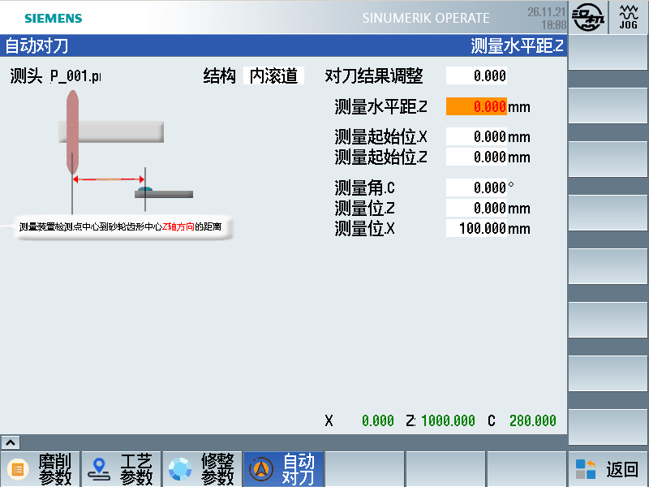
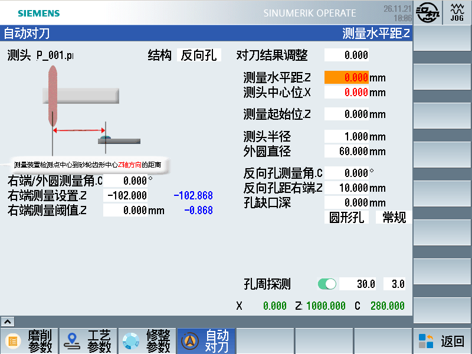
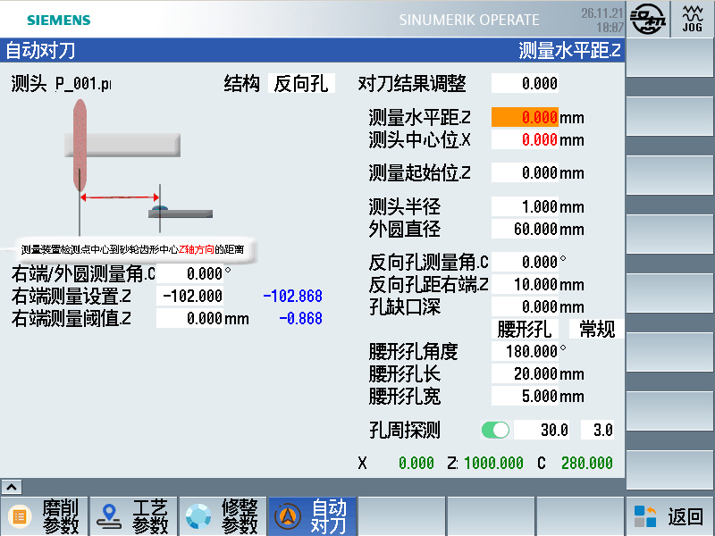
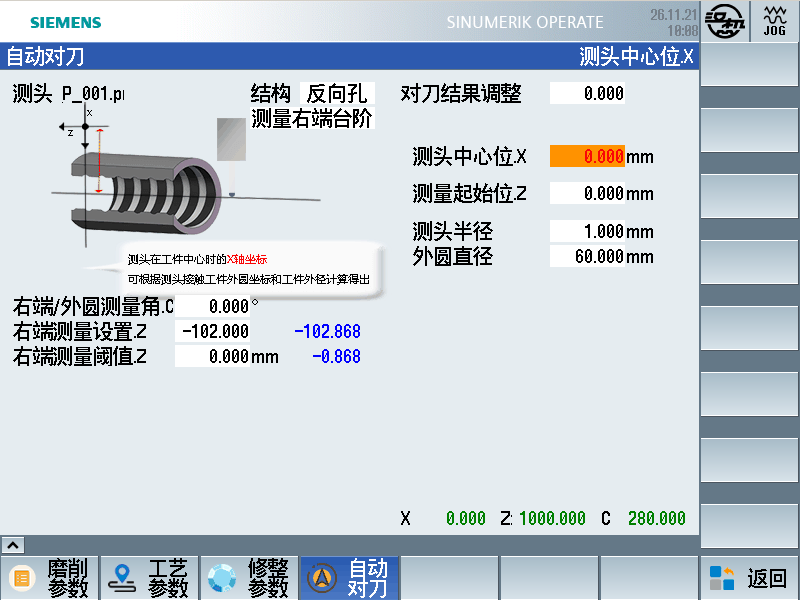
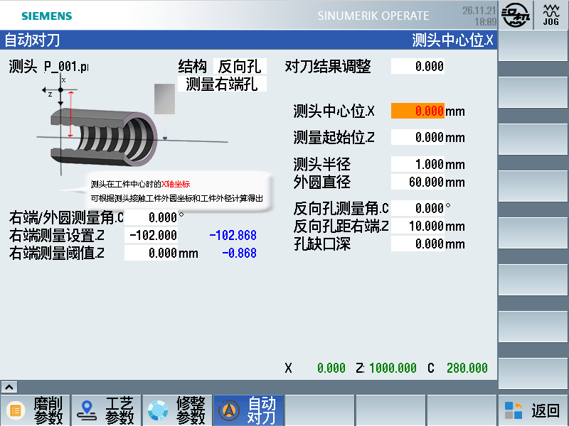
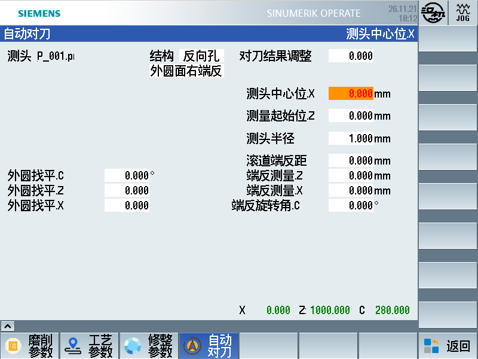

[HMI界面参数定义](index.html)

---

自动对刀界面

---

具体操作步骤请参考[对刀](section_11.html)  
机床配置有自动对刀机构时，屏幕下方出现 **自动对刀** 软键，点击进入本页  
自动对刀：点亮操作面板上的自动对刀键后按循环启动，测量机构（接近开关或测头）自动伸出，找到工件上的定位基准，计算出 **加工起始角.C**，测量完成后机构退回，无需手动对刀  
自动对刀只计算加工起始角.C，不改变初始接触.X；测量成功后当前接触.X 复位为初始接触.X，工艺累计进刀清零，相当于从头开始磨削这个工件  
测头/开关每次寻找边缘时先快速接触，再退开慢速复测一次，以慢速结果为准；机床配置可改为只检测一次  
页面左上角实时显示测量机构的信号状态（点亮表示检测到工件），底部显示 X、Z、C 轴实时坐标，便于手动标定各位置

---

通用参数

---

|  |  |
| --- | --- |
| 对刀结果调整 | 推荐设置：按偏刀情况 |
| 取值范围 | 无（单位：mm 或 °（见说明）） |

自动对刀完成并磨削后，如果发现螺纹两侧磨削不均（偏刀），用此值修正自动对刀的结果  
该值会持续叠加在每次自动对刀结果上，调整后无需重新标定测量机构  

内螺纹测量内滚道、测量反向孔（常规）、外圆面右端反：单位为 mm，相当于把测量到的位置沿 Z 向平移；测量反向孔（只测C）、测量右端台阶、测量右端孔：单位为 °，直接叠加到算出的加工起始角上

内螺纹自动对刀

---

内螺纹机床把测量机构伸入或贴近工件，测量定位基准。左上角 **结构** 决定用哪种方式测量，页面随之切换：  
**内滚道**：接近开关伸入工件内孔，沿 Z 向找到一个螺纹槽的两侧，以槽中心定位  
**反向孔**：测头测量螺母上的反向器孔（或其它定位基准），以孔中心定位  
机床配置开启 **可选测量右端小台阶/定位孔** 后，反向孔页面上方多出 **测量模式**，还可选择测量右端台阶、测量右端孔、外圆面右端反  
测头在工件后方还是前方由机床配置中的 **测量方向** 决定，界面数值均按实际坐标输入即可  
测量结束后测量机构退回，Z 轴回到测量起始位.Z，再退到磨削界面的安全位置.Z，X 轴回到工件中心.X

|  |  |
| --- | --- |
| 结构 | 推荐设置：无 |
| 取值范围 | 内滚道/反向孔 |

按机床配置的测量机构和工件的定位基准选择，切换后页面显示对应的参数  
**内滚道**：用接近开关测量螺纹槽  
**反向孔**：用测头测量反向孔、右端台阶、右端孔或外圆找平面  
*修改权限：钥匙开关3档及以上*

|  |  |
| --- | --- |
| 测量水平距.Z | 推荐设置：按测量计算 |
| 取值范围 | 无（单位：mm） |

测量机构（测头或开关）与砂轮在 Z 方向的距离，直接影响磨削是否偏刀，需准确标定：  
1. 用测头接触工件右端面，记录 Z 坐标 Z1  
2. 将砂轮齿顶对准工件右端面，记录 Z 坐标 Z2  
3. 测量水平距 = |Z1 - 测头半径 - Z2|  
用于内滚道、测量反向孔（常规）；测量右端台阶、测量右端孔、只测C、外圆面右端反不使用此值  
*修改权限：钥匙开关3档及以上*

|  |  |
| --- | --- |
| 测量起始位.Z | 推荐设置：测头在工件外约 50mm |
| 取值范围 | 无（单位：mm） |

每次自动对刀开始时 Z 轴先移动到此位置，再伸出测量机构；测量结束后也回到此位置  
应保证测量机构伸出时与工件、卡盘之间留有足够距离  
*修改权限：钥匙开关3档及以上*

|  |  |
| --- | --- |
| 测量角.C / 反向孔测量角.C | 推荐设置：测量机构能正对测量位置 |
| 取值范围 | ≥ 0（单位：°） |

**内滚道**（显示为测量角.C）：开关伸出前头架转到的角度，保证开关伸入内孔时不与工件干涉  
**测量反向孔**：头架转到此角度时，测头应正对反向孔，能伸入孔的中部  
**测量右端孔**：头架转到此角度时，测头应正对右端定位孔  
*修改权限：钥匙开关3档及以上*

结构：内滚道（接近开关）

---

  

测量过程：Z 轴到测量起始位，C 轴转到测量角，开关伸出；X 轴移到测量起始位.X，Z 轴移到测量位.Z；X 轴移向测量位.X（此时开关应处在螺纹槽内、没有信号），然后 Z 轴先向左、再向右移动（各最多 2 个螺距），分别碰到螺纹槽两侧牙侧，取中点作为槽中心，换算出加工起始角  
如果开关移向测量位.X 时碰在牙顶上：默认沿 Z 向移动 1/4 螺距离开后再找槽；机床配置开启 **测量内滚道-后退平移调整位置** 后，改为先退回测量起始位.X、沿 Z 向平移 1/8 螺距再试，最多 5 次，仍失败则停机提示"测量失败, 请检查测量位置设置是否合适"  
两侧找不到牙侧时报警"检测不到信号,检查测量位.X是否合适!"

|  |  |
| --- | --- |
| 测量起始位.X | 推荐设置：无 |
| 取值范围 | 无（单位：mm） |

开关能安全进入工件内孔、又不碰到孔壁的 X 坐标；测量结束后开关先退回到此 X 位置再退出工件  
*修改权限：钥匙开关3档及以上*

|  |  |
| --- | --- |
| 测量位.Z | 推荐设置：开关在第一个螺纹槽内 |
| 取值范围 | 无（单位：mm） |

手动将开关伸入工件，大致对准第一个螺纹槽中间，记录此时 Z 坐标。开关在此 Z 位置移到测量位.X，然后沿 Z 向两侧找槽的牙侧，因此应保证此位置在槽内  
*修改权限：钥匙开关3档及以上*

|  |  |
| --- | --- |
| 测量位.X | 推荐设置：检测到信号后再靠近 0.2mm 左右 |
| 取值范围 | 无（单位：mm） |

开关靠近内孔表面的目标 X 坐标：手动移动 X 轴直到开关刚检测到孔壁，再往孔壁方向多走约 0.2mm，记录此坐标  
开关在螺纹槽内移到此位置时不应有信号，沿 Z 向移动碰到牙侧时才有信号；设置过浅会检测不到牙侧，过深可能碰撞工件  
*修改权限：钥匙开关3档及以上*

结构：反向孔（测头）

---

  

测量过程（测量反向孔）：Z 轴到测量起始位，头架转到 右端/外圆测量角，X 轴移到工件外圆外 5mm 处，测头伸出；测头径向移入外圆以内约 1.5 个测头直径，沿 Z 向（最多 100mm）碰到工件右端面（与右端测量设置比较，超出阈值报警"工件右端过长"）；然后退回外圆外 5mm，转到反向孔测量角，从测得的右端面向工件内移动 反向孔距右端.Z，伸入孔内，正反转 C 轴（各最多 300°）找孔的上下两侧，再沿 Z 向（各最多 2 个螺距）找左右两侧，得到孔中心，换算出加工起始角  
测量右端台阶、测量右端孔模式同样先测右端面；外圆面右端反模式不测右端面  
测头伸不进孔（碰到孔外沿）时报警"测头无法进入孔内,请检查参数设置!"；找不到右端面或在 C 向、Z 向找不到孔壁时报警"工件外径设置有误!"，请检查外圆直径、测头中心位、反向孔距右端等参数

|  |  |
| --- | --- |
| 测量模式 | 推荐设置：无 |
| 取值范围 | 测量反向孔/测量右端台阶/测量右端孔/外圆面右端反 |

需在机床配置中开启 **可选测量右端小台阶/定位孔** 后显示，未开启时固定为测量反向孔  
各模式的测量方式和参数见下方说明  
*修改权限：钥匙开关3档及以上*

|  |  |
| --- | --- |
| 测头中心位.X | 推荐设置：无 |
| 取值范围 | 无（单位：mm） |

测头位于工件回转中心时的 X 坐标。可用测头接触工件外圆的坐标加（或减）工件半径计算得到  
程序以此为基准，按外圆直径计算测头靠近工件外表面的位置  
*修改权限：钥匙开关3档及以上*

|  |  |
| --- | --- |
| 测头半径 | 推荐设置：按测头图纸 |
| 取值范围 | 0~10（单位：mm） |

测头测球的半径，按测头规格输入。程序用它计算测头伸入工件的深度和接触点修正  
*修改权限：钥匙开关3档及以上*

|  |  |
| --- | --- |
| 外圆直径 | 推荐设置：实测 |
| 取值范围 | 0~500（单位：mm） |

工件外圆直径，决定测头靠近工件外表面的位置，以及腰形孔尺寸换算成 C 轴角度，需准确输入  
*修改权限：钥匙开关3档及以上*

|  |  |
| --- | --- |
| 反向孔距右端.Z | 推荐设置：测头能进入孔中部 |
| 取值范围 | 0~500（单位：mm） |

**测量反向孔**：工件右端面到反向孔中心的 Z 向距离，测头从测得的右端面位置向工件内移动此距离到达孔位置  
**测量右端孔**：测头沿 Z 向伸入右端定位孔的深度  
*修改权限：钥匙开关3档及以上*

|  |  |
| --- | --- |
| 孔缺口深 | 推荐设置：按工件 |
| 取值范围 | -20~100（单位：mm） |

**测量反向孔**：反向孔外侧有缺口（沉孔）时，测头需要多伸入的深度；无缺口输入 0  
**测量右端孔**：右端定位孔中心到工件外圆表面的径向距离  
*修改权限：钥匙开关3档及以上*

|  |  |
| --- | --- |
| 反向孔类型 | 推荐设置：无 |
| 取值范围 | 圆形孔/腰形孔 |

按工件反向孔形状选择  
**圆形孔**：C 向找上下两侧、Z 向找左右两侧  
**腰形孔**：沿腰形孔的宽、长方向斜向找边，需继续设置腰形孔角度、长、宽（见下图）  
*修改权限：钥匙开关3档及以上*

|  |  |
| --- | --- |
| 测量模式（常规/只测C） | 推荐设置：常规 |
| 取值范围 | 常规/只测C |

**常规**：测量孔的上下（C 向）和左右（Z 向），定位孔中心并计算加工起始角  
**只测C**：只测上下方向得到孔的角度位置；右端面的测量误差自动写入磨削界面的 **偏刀补偿**，对刀结果调整按角度（°）叠加  
*修改权限：钥匙开关3档及以上*

|  |  |
| --- | --- |
| 孔周探测 / 探测范围 / 探测步距 | 推荐设置：范围 30°，步距 5° |
| 取值范围 | 孔周探测 关/开；探测范围、探测步距 0~360（单位：°） |

工件孔小或装夹角度不准时打开：测头按设定角度伸不进反向孔时，头架先向一个方向、再向另一个方向按步距逐次转动（各转到探测范围的一半），每次重新尝试伸入孔内  
*修改权限：钥匙开关3档及以上*

|  |  |
| --- | --- |
| 右端/外圆测量角.C（外圆找平.C） | 推荐设置：测头测量时不干涉 |
| 取值范围 | 0~360（单位：°） |

自动对刀开始时头架转到的角度，测头在此角度伸出并测量右端面或外圆，应保证测头不碰卡爪、缺口等  
外圆面右端反模式下此项显示为 **外圆找平.C**，即测量外圆找平面时的起始角度  
*修改权限：钥匙开关3档及以上*

|  |  |
| --- | --- |
| 右端测量设置.Z / 右端实际测量 | 推荐设置：手动测量后设置 |
| 取值范围 | 无（单位：mm） |

手动用测头接触工件右端面，把 Z 坐标输入 **右端测量设置**；右侧显示每次自动测量得到的实际值  
*修改权限：钥匙开关3档及以上*

|  |  |
| --- | --- |
| 右端测量阈值.Z / 右端测量误差 | 推荐设置：0.05 |
| 取值范围 | 0~0.5（单位：mm） |

右侧显示本次测得的右端面与设置值之差（实测 - 设置）。差值大于阈值时报警"工件右端过长，检查是否放置有误或重新设置右端磨削位置"，程序停止；反方向的偏差不报警  
超差通常是工件过长或装夹未到位，检查工件或修改右端测量设置后继续  
*修改权限：钥匙开关3档及以上*

反向孔类型：腰形孔

---

  

|  |  |
| --- | --- |
| 腰形孔角度 / 腰形孔长 / 腰形孔宽 | 推荐设置：按图纸（展开图尺寸） |
| 取值范围 | 角度 0~180，长宽 0~100（单位：° / mm） |

腰形孔在工件外圆展开图上的倾斜角度及长、宽。参考界面示意图设置，一般右旋工件角度大于 90°，左旋工件小于 90°  
测头沿孔宽方向找两边得到孔的中线，再沿孔长方向找两端得到孔中心  
*修改权限：钥匙开关3档及以上*

测量模式：测量右端台阶

---

  

用工件右端面上的小台阶确定角度：测头先测出右端面，再沿 Z 向后退半个测头半径，头架正转一整圈内找到台阶侧面，以此角度加上对刀结果调整作为加工起始角；右端面的误差自动写入磨削界面的偏刀补偿  
转一整圈仍未碰到台阶时报警"工件外径设置有误!"  
本模式只需设置测头中心位、测量起始位、测头半径、外圆直径和右端测量相关参数

测量模式：测量右端孔

---

  

用工件右端面上的定位孔确定角度：测头先测出右端面，再移到定位孔所在半径（外圆半径减去 **孔缺口深** 中填写的孔中心到外圆距离），头架转到 **反向孔测量角.C**，测头沿 Z 向伸入孔内 **反向孔距右端.Z** 的深度，然后正反转 C 轴（各最多 40°）找孔两侧，取中点加上对刀结果调整作为加工起始角；右端面的误差自动写入磨削界面的偏刀补偿  
伸不进孔时报警"测头无法进入孔内,请检查参数设置!"；±40° 内找不到孔壁时报警"工件外径设置有误!"  
本模式借用反向孔的三个参数，含义见上方对应参数说明

测量模式：外圆面右端反

---

  

用工件外圆上的找平面（如铣扁、键槽）确定角度，再用右端反向器端面确定 Z 向位置：  
1. 头架转到外圆找平.C，测头移到外圆找平.Z / 外圆找平.X，正反转 C 轴测出找平面两侧，取中点作为角度基准  
2. 测头退出后回到工件中心，头架再转动 **端反旋转角.C**，测头移到 **端反测量.Z / 端反测量.X**，沿 Z 向接触右端反向器端面  
3. 测得的端面位置（扣除对刀结果调整）加上 **滚道端反距**，换算成砂轮到滚道起点的角度，得到加工起始角  
找平面或端面碰不到时停机提示"测量错误,测头未检测到信号"

|  |  |
| --- | --- |
| 外圆找平.C / 外圆找平.Z / 外圆找平.X | 推荐设置：无 |
| 取值范围 | 无 |

测头在工件外圆找平面上测量的位置：头架先转到外圆找平.C，测头移到外圆找平.Z、外圆找平.X（贴近找平面），正反转动 C 轴测出平面两侧  
手动把测头移到找平面中间、刚好能检测到信号的位置，记录 Z、X 坐标  
*修改权限：钥匙开关3档及以上*

|  |  |
| --- | --- |
| 滚道端反距 | 推荐设置：无 |
| 取值范围 | 0~500（单位：mm） |

右端反向器端面到滚道磨削起点的 Z 向距离，用于把测得的端面位置换算成加工起始角  
*修改权限：钥匙开关3档及以上*

|  |  |
| --- | --- |
| 端反测量.Z / 端反测量.X / 端反旋转角.C | 推荐设置：无 |
| 取值范围 | 无 |

测量右端反向器端面时测头的 Z、X 位置，以及找平之后头架需要再转动的角度（使测头能伸到端反位置）  
测头先移到端反测量.Z 外侧，再移到端反测量.X，然后沿 Z 向接触端面  
*修改权限：钥匙开关3档及以上*
