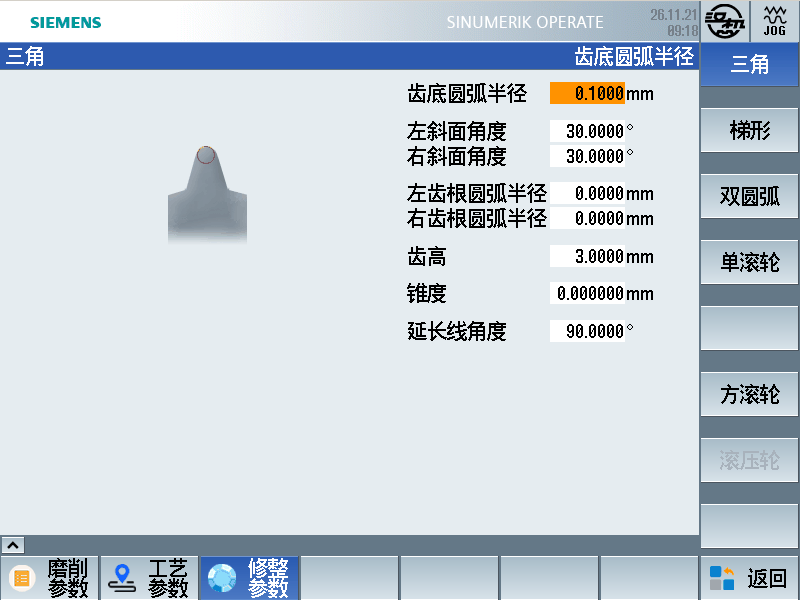
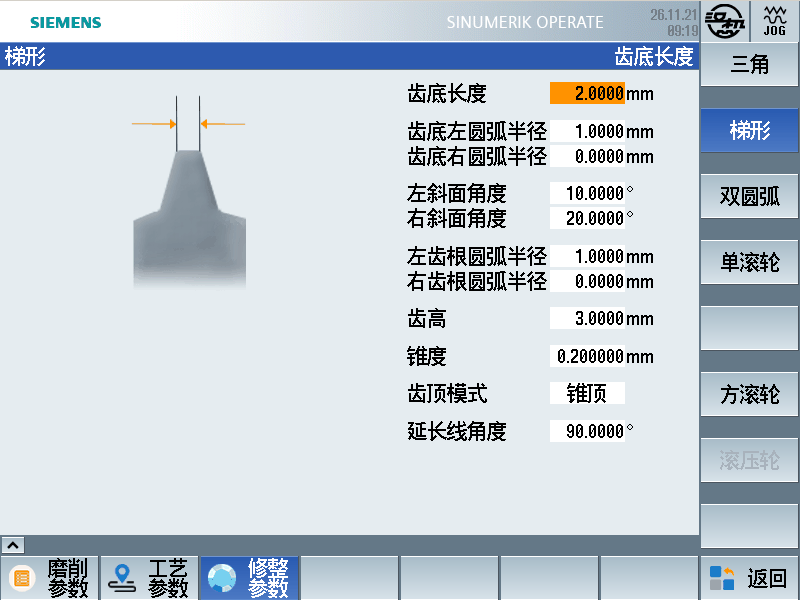
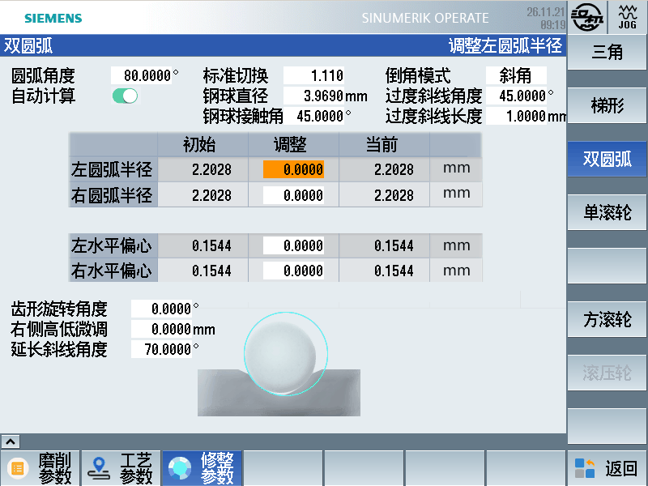

[HMI界面参数定义](index.html)

---

齿型界面

---

具体操作步骤请参考[砂轮修整](section_10.html)  
插补修整时，在修整界面点击右侧 **三角 / 梯形 / 双圆弧 / 行星齿** 软键进入对应齿形页面，设置要修出的砂轮齿形；页面左侧示意图标出了各尺寸的位置  
修改齿形参数后需执行一次修整，新齿形才会修到砂轮上

---

三角齿形

---

  

用于普通三角螺纹（公制、英制等）。机床配置开启"三角齿型-修整模式选择"后，左上角可选 **普通** 或 **扩展** 模式：  
**普通**：单段斜面，左右斜面角度 + 齿高  
**扩展**：上下两段不同角度的斜面（上段/下段），用于齿侧带折线的特殊齿形

|  |  |
| --- | --- |
| 齿底圆弧半径 | 推荐设置：无 |
| 取值范围 | 0~20（单位：mm） |

砂轮齿顶（对应工件牙底）的圆弧半径，按工件图纸牙底圆弧设置  
*修改权限：钥匙开关3档及以上*

|  |  |
| --- | --- |
| 左斜面角度 / 右斜面角度（扩展模式分上、下两段） | 推荐设置：按图纸，如公制 30°/30° |
| 取值范围 | 0~90（单位：°） |

齿形左右两侧斜面与竖直方向的夹角（半角），对称齿形左右相等  
扩展模式下 **上-** 为靠近齿顶一段，**下-** 为靠近齿根一段  
*修改权限：钥匙开关3档及以上*

|  |  |
| --- | --- |
| 齿高（扩展模式为上-齿高、总-齿高） | 推荐设置：无 |
| 取值范围 | 0~50（单位：mm） |

修出的砂轮齿形高度，应略大于工件牙深，保证磨削时只有齿侧接触  
扩展模式下 **上-齿高** 为上段斜面高度，**总-齿高** 为整个齿高  
*修改权限：钥匙开关3档及以上*

|  |  |
| --- | --- |
| 左齿根圆弧半径 / 右齿根圆弧半径 | 推荐设置：无 |
| 取值范围 | 0~20（单位：mm） |

砂轮齿根两侧（对应工件牙顶倒角处）的过渡圆弧，不需要时输入 0  
*修改权限：钥匙开关3档及以上*

|  |  |
| --- | --- |
| 锥度 | 推荐设置：无 |
| 取值范围 | -90~90 |

修整出带锥度的砂轮外形（齿顶连线倾斜），用于锥度螺纹专用砂轮；普通螺纹输入 0  
*修改权限：钥匙开关3档及以上*

|  |  |
| --- | --- |
| 延长线角度 | 推荐设置：90 |
| 取值范围 | 0~90（单位：°） |

齿高以外延长部分（砂轮外侧轮廓）的角度，90° 为竖直向外延伸  
*修改权限：钥匙开关3档及以上*

|  |  |
| --- | --- |
| 三角模式（普通/扩展） | 推荐设置：无 |
| 取值范围 | 普通/扩展 |

**普通**：单段斜面三角齿形  
**扩展**：上下两段不同角度斜面的三角齿形  
需在机床配置中开启 **三角齿型-修整模式选择** 后显示；未开启时三角齿形固定为普通模式  
*修改权限：钥匙开关3档及以上*

梯形齿形

---

  

用于梯形螺纹、蜗杆等平底齿形。机床配置开启"梯形齿型-修整模式选择"后，左上角可选：  
**普通**：单段斜面梯形  
**扩展**：上下两段不同角度斜面的梯形，可选平顶或锥顶  
**戴帽**：按中径宽度、中径高度定义的梯形（齿顶带帽形过渡）

|  |  |
| --- | --- |
| 齿底长度 | 推荐设置：无 |
| 取值范围 | 0~20（单位：mm） |

砂轮齿顶平面（对应工件牙底）的宽度，按工件牙底宽设置  
*修改权限：钥匙开关3档及以上*

|  |  |
| --- | --- |
| 齿底左圆弧半径 / 齿底右圆弧半径 | 推荐设置：无 |
| 取值范围 | 0~20（单位：mm） |

齿底平面两端的过渡圆弧半径  
*修改权限：钥匙开关3档及以上*

|  |  |
| --- | --- |
| 左斜面角度 / 右斜面角度（扩展模式分上、下两段） | 推荐设置：无 |
| 取值范围 | 0~90（单位：°） |

梯形两侧斜面与竖直方向的夹角（半角），如 30° 梯形螺纹两侧各输入 15°  
*修改权限：钥匙开关3档及以上*

|  |  |
| --- | --- |
| 齿高（扩展模式为上-齿高、总-齿高） | 推荐设置：无 |
| 取值范围 | 0~50（单位：mm） |

修出的砂轮齿形高度，应略大于工件牙深  
*修改权限：钥匙开关3档及以上*

|  |  |
| --- | --- |
| 左齿根圆弧半径 / 右齿根圆弧半径 | 推荐设置：无 |
| 取值范围 | 0~20（单位：mm） |

砂轮齿根两侧的过渡圆弧，不需要时输入 0  
*修改权限：钥匙开关3档及以上*

|  |  |
| --- | --- |
| 锥度 / 延长线角度 | 推荐设置：无 |
| 取值范围 | 锥度 -90~90，角度 0~90 |

含义同三角齿形：锥度用于锥度专用砂轮，普通螺纹输入 0；延长线角度为齿高以外轮廓的角度  
*修改权限：钥匙开关3档及以上*

|  |  |
| --- | --- |
| 齿顶模式 | 推荐设置：无 |
| 取值范围 | 平顶/锥顶 |

砂轮齿根处（对应工件牙顶）为平面或锥面  
*修改权限：钥匙开关3档及以上*

|  |  |
| --- | --- |
| 戴帽梯形参数 | 推荐设置：无 |
| 取值范围 | 按图纸（单位：mm / °） |

梯形模式选择 **戴帽** 时显示，按工件图纸输入：  
**螺距**、**锥度**：齿形对应的螺距与锥度  
**中径宽度 / 中径高度**：中径处的齿宽及其距齿底的高度  
**齿底高度**：齿底平面所在高度  
**左/右半角**：两侧齿面半角  
**左/右齿尖R、左/右齿底R**：齿尖和齿底的过渡圆弧  
**延长斜线角度**：齿形以外轮廓的角度  
*修改权限：钥匙开关3档及以上*

|  |  |
| --- | --- |
| 梯形模式（普通/扩展/戴帽） | 推荐设置：无 |
| 取值范围 | 普通/扩展/戴帽 |

**普通**：单段斜面梯形  
**扩展**：上下两段斜面梯形  
**戴帽**：按中径宽度与高度定义的梯形  
需在机床配置中开启 **梯形齿型-修整模式选择** 后显示；未开启时梯形齿形固定为普通模式  
*修改权限：钥匙开关3档及以上*

双圆弧齿形（滚珠丝杠/螺母）

---

  

用于滚珠丝杠、滚珠螺母的哥特式（双圆弧）滚道。表格中每项分为 **初始 / 调整 / 当前** 三列：  
**初始**：标准值（按图纸输入或由钢球直径自动计算）  
**调整**：根据加工后的测量报告输入的修正量  
**当前**：初始 + 调整，修整时实际使用的值（只读）

|  |  |
| --- | --- |
| 圆弧角度 | 推荐设置：按需要修出的圆弧范围 |
| 取值范围 | 20~90（单位：°） |

修出的滚道圆弧所对应的角度（与竖直方向的夹角），设为 90° 时修出完整半圆  
*修改权限：钥匙开关3档及以上*

|  |  |
| --- | --- |
| 自动计算 | 推荐设置：无 |
| 取值范围 | 关/开 |

打开后按钢球直径和接触角自动计算初始圆弧半径与水平偏心：  
圆弧半径 = 标准切换系数 × 钢球直径 / 2  
水平偏心 = (圆弧半径 - 钢球直径 / 2) × sin(接触角)  
*修改权限：钥匙开关3档及以上*

|  |  |
| --- | --- |
| 标准切换 | 推荐设置：1.11 |
| 取值范围 | 0.9~1.2 |

自动计算时圆弧半径与钢球半径的比值（适配系数），按滚道设计标准选择，常用 1.11  
*修改权限：钥匙开关3档及以上*

|  |  |
| --- | --- |
| 钢球直径 | 推荐设置：无 |
| 取值范围 | 0~50（单位：mm） |

滚珠直径，打开自动计算时需要输入  
*修改权限：钥匙开关3档及以上*

|  |  |
| --- | --- |
| 钢球接触角 | 推荐设置：45° |
| 取值范围 | 0~90（单位：°） |

钢球与滚道的接触角，打开自动计算时需要输入  
*修改权限：钥匙开关3档及以上*

|  |  |
| --- | --- |
| 初始左圆弧半径 / 初始右圆弧半径 | 推荐设置：按图纸或自动计算 |
| 取值范围 | 0~50（单位：mm） |

左、右滚道圆弧半径的标准值  
*修改权限：钥匙开关3档及以上*

|  |  |
| --- | --- |
| 调整左圆弧半径 / 调整右圆弧半径 | 推荐设置：按测量报告 |
| 取值范围 | -10~10（单位：mm） |

根据加工后的测量报告对左、右圆弧半径的修正量，叠加到初始值上  
*修改权限：钥匙开关3档及以上*

|  |  |
| --- | --- |
| 当前左圆弧半径 / 当前右圆弧半径 | 推荐设置：无 |
| 取值范围 | 只读（单位：mm） |

初始值 + 调整值，修整时实际使用的圆弧半径  
*界面只读显示，由程序自动写入*

|  |  |
| --- | --- |
| 左/右圆弧理论水平偏心 | 推荐设置：按图纸或自动计算 |
| 取值范围 | 0~10（单位：mm） |

左、右圆弧圆心相对齿形中心的水平偏移标准值  
*修改权限：钥匙开关3档及以上*

|  |  |
| --- | --- |
| 调整左/右圆弧水平偏心 | 推荐设置：按测量报告 |
| 取值范围 | -10~10（单位：mm） |

根据测量报告对水平偏心的修正量，叠加到理论值上  
*修改权限：钥匙开关3档及以上*

|  |  |
| --- | --- |
| 当前左/右圆弧水平偏心 | 推荐设置：无 |
| 取值范围 | 只读（单位：mm） |

理论值 + 调整值，修整时实际使用的水平偏心  
*界面只读显示，由程序自动写入*

|  |  |
| --- | --- |
| 倒角模式 | 推荐设置：无 |
| 取值范围 | 斜角/圆角 |

滚道两侧到砂轮外缘的过渡方式，按图纸要求选择  
**斜角**：用过渡斜线角度、过渡斜线长度定义  
**圆角**：用圆角半径定义，修整轮圆弧半径需小于圆角半径  
*修改权限：钥匙开关3档及以上*

|  |  |
| --- | --- |
| 过渡斜线角度 / 过渡斜线长度 | 推荐设置：无 |
| 取值范围 | 角度 0~90，长度 0~20 |

斜角倒角的角度（与水平方向夹角，0° 为水平修出）和斜线长度；长度至少为一个修整轮圆弧半径  
*修改权限：钥匙开关3档及以上*

|  |  |
| --- | --- |
| 圆角半径 | 推荐设置：无 |
| 取值范围 | 0~20（单位：mm） |

倒角模式为圆角时的过渡圆弧半径  
*修改权限：钥匙开关3档及以上*

|  |  |
| --- | --- |
| 齿形旋转角度 | 推荐设置：按测量结果微调 |
| 取值范围 | -5~5（单位：°） |

保持圆弧半径不变，将整个齿形旋转一个小角度，用于调整左右接触角对称  
正值逆时针旋转，负值顺时针旋转；只能小幅微调  
*修改权限：钥匙开关3档及以上*

|  |  |
| --- | --- |
| 右侧高低微调 | 推荐设置：无 |
| 取值范围 | -0.2~0.2（单位：mm） |

需要调整接触角又不想改动圆弧时，微调齿形右侧高低：正值右侧抬高，负值右侧降低  
*修改权限：钥匙开关3档及以上*

|  |  |
| --- | --- |
| 延长斜线角度 | 推荐设置：无 |
| 取值范围 | 0~90（单位：°） |

滚道以外延长部分轮廓的角度  
*修改权限：钥匙开关3档及以上*

多线修整（多牙砂轮）

---

需在机床配置中开启后显示于各齿形页面左下方，用于把砂轮修成多个牙（多线砂轮），一次磨削多个牙以提高效率

|  |  |
| --- | --- |
| 多线修整 | 推荐设置：无 |
| 取值范围 | 否/是 |

选择是后，按下方牙数在砂轮宽度方向连续修出多个相同齿形  
需在机床配置中开启 **三角齿型-修整模式选择**、**梯形齿型-修整模式选择** 或 **双圆弧齿型-扩展模式** 后，在对应齿形页面显示  
*修改权限：钥匙开关3档及以上*

|  |  |
| --- | --- |
| 牙数 | 推荐设置：无 |
| 取值范围 | ≥ 1 |

砂轮上要修出的牙数，砂轮宽度需足够容纳 牙数 × 螺距  
需在机床配置中开启 **三角齿型-修整模式选择**、**梯形齿型-修整模式选择** 或 **双圆弧齿型-扩展模式** 后，在对应齿形页面显示  
*修改权限：钥匙开关3档及以上*

|  |  |
| --- | --- |
| 间隔螺距 | 推荐设置：无 |
| 取值范围 | 0~5 |

相邻两牙之间相隔的螺距数，0 表示牙与牙紧挨着连续排列  
需在机床配置中开启 **三角齿型-修整模式选择**、**梯形齿型-修整模式选择** 或 **双圆弧齿型-扩展模式** 后，在对应齿形页面显示  
*修改权限：钥匙开关3档及以上*

|  |  |
| --- | --- |
| 齿高补偿 | 推荐设置：无 |
| 取值范围 | -1~1（单位：mm） |

各牙之间逐个递减的齿高量，使先接触工件的牙承担更多切削量；正值时越靠左的牙越矮  
需在机床配置中开启 **三角齿型-修整模式选择**、**梯形齿型-修整模式选择** 或 **双圆弧齿型-扩展模式** 后，在对应齿形页面显示  
*修改权限：钥匙开关3档及以上*
