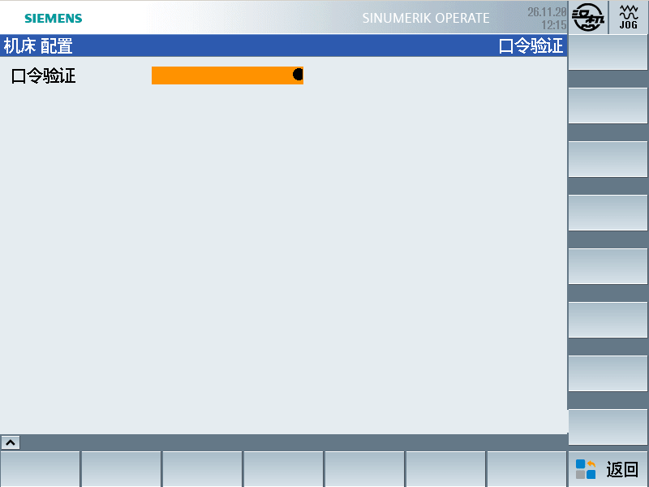
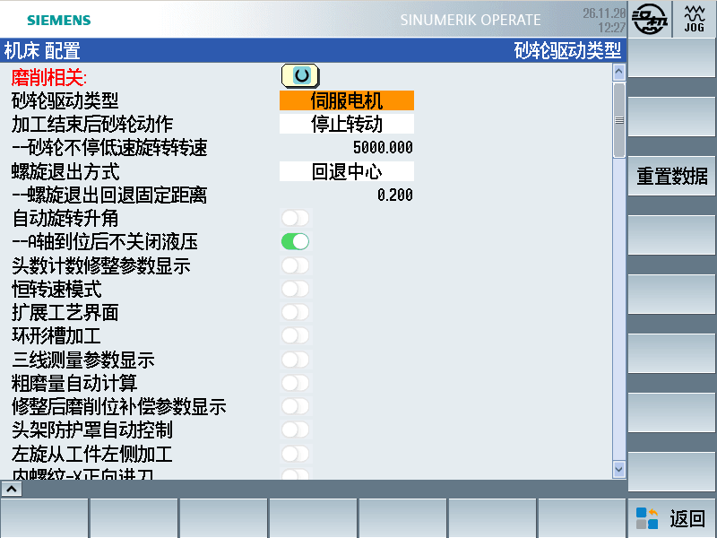

[HMI界面参数定义](index.html)

---

机床配置界面

---

机床配置界面是制造商/服务人员使用的配置管理界面，用于设定机床结构、功能开关和输入限制  
进入方法：欢迎页右侧点击扩展菜单（▷），再点击 **机床配置**；进入时需输入口令验证，**如需访问请联系机床制造商获取口令**  
配置项修改后立即生效，错误的配置可能导致机床动作异常，请勿自行修改

---

口令验证

---

  

|  |  |
| --- | --- |
| 口令验证 | 推荐设置：无 |
| 取值范围 | 6 位数字 |

点击右侧第三个软键，屏幕右下角显示 6 位挑战码；将挑战码提供给制造商，获得解锁口令后输入此框并按输入键  
每次点击该软键都会更换新的挑战码；口令错误时提示"口令错误"  
*修改权限：用户口令及以上*

配置列表

---

  

解锁后显示配置列表，用上下翻页键浏览。开关类项目点击后用选择键切换，数值类项目直接输入  
右侧 **重置数据** 软键：将各配置恢复为本机出厂默认值（新程序导入后首次使用时必须执行一次），按确认后执行

|  |  |
| --- | --- |
| 磨削相关 | 推荐设置：无 |
| 取值范围 | 见下表 |

砂轮驱动类型、加工结束后砂轮动作、螺旋退出方式、自动旋转升角、恒转速模式、扩展工艺界面、环形槽加工、三线测量显示、粗磨量自动计算、修整后磨削位补偿显示、左旋加工方向、自动门控制、断电回退、冷却附加通道、压力显示、双向进刀量模式等  
*修改权限：用户口令及以上*

|  |  |
| --- | --- |
| 修整相关 | 推荐设置：无 |
| 取值范围 | 见下表 |

修整轮驱动类型、加工结束后修整轮动作、新砂轮抬刀模式、通用齿型平面、修整 A 轴角度显示、修整轮反转、外部齿型程序、每修整 20 次调节转速、提前启动滚轮、新砂轮可选成型、三角/梯形/双圆弧齿型模式选择、附加齿型、新砂轮轮廓单独参数、成型轮左右靠磨、平面修砂轮等  
*修改权限：用户口令及以上*

|  |  |
| --- | --- |
| 对刀相关 | 推荐设置：无 |
| 取值范围 | 见下表 |

手动对刀模式（插补对刀/静止对刀）、手动对刀角度、非首件自动开到初始接触、自动对刀机构及测量方式、测头汽缸检测开关、测量方向、内螺纹自动对刀模式等  
*修改权限：用户口令及以上*

|  |  |
| --- | --- |
| 隐藏界面激活 | 推荐设置：无 |
| 取值范围 | 开/关 |

控制以下功能界面是否在 HMI 中显示：参数备份恢复、加工统计、修整轮生命周期统计、机械手选项、螺距变换（单/多）、自磨夹具、反向孔倒角、变径磨削、空运行热机、分段补偿、工艺附加配置、Y 轴设置、配件寿命  
关闭的功能对应软键不显示，相关参数也不生效  
*修改权限：用户口令及以上*

|  |  |
| --- | --- |
| 界面部分参数输入范围限制 | 推荐设置：无 |
| 取值范围 | 0 表示使用默认限制 |

限制操作人员在界面上可输入的范围，防止误输入：  

安全位置.Z 距工件右端的最小距离  

中径调整、工艺进给、工艺头架转速、修整进给的上限  

*修改权限：用户口令及以上*

| 配置项（示例） | 作用 |
| --- | --- |
| 加工结束后砂轮动作 | 程序结束后砂轮停止、保持原速或保持低速旋转 |
| 恒转速模式 | 打开后工艺/修整界面直接输入砂轮转速，线速度随直径变化 |
| 扩展工艺界面 | 打开后工艺表中每道工序有独立修整参数 |
| 粗磨量自动计算 | 打开后输入设定磨削总量，粗磨进给自动反算 |
| 结束自动关闭修整/对刀键 | 修整或对刀完成后自动关闭操作面板上的对应功能键 |
| 断电回退使能 | 断电时砂轮自动后退一段距离，防止撞伤工件 |
| 有自动对刀机构 | 打开后显示自动对刀界面与功能 |
| 螺距变换 | 关/单/多：分别对应不显示、单段螺距变换、多段螺距变换界面 |
