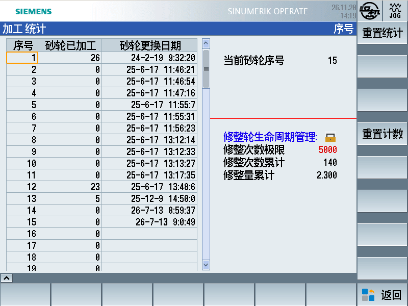
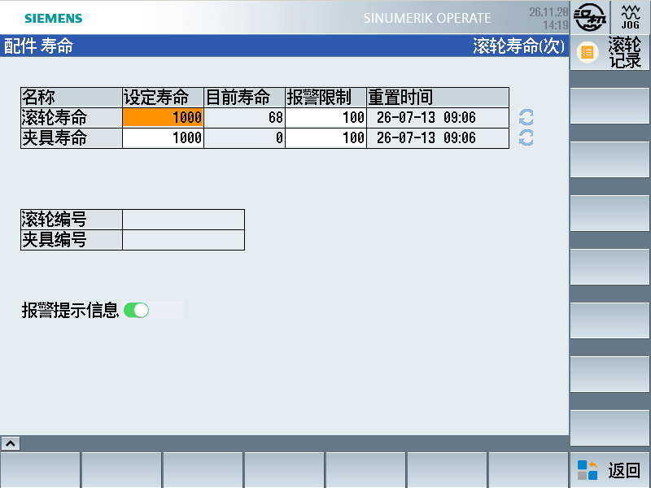
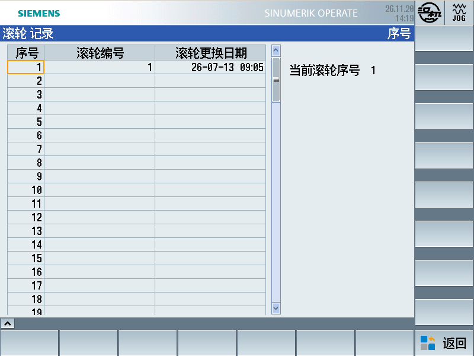

[HMI界面参数定义](index.html)

---

加工统计与配件寿命界面

---

具体操作请参考[加工统计与配件寿命](section_15.html)  
两个界面需在机床配置中开启后，才会在欢迎页右侧显示 **加工统计**、**配件寿命** 软键

---

加工统计

---

  

按砂轮记录每片砂轮加工的工件数量和更换日期，便于统计砂轮寿命。进入需钥匙开关 3 档

|  |  |
| --- | --- |
| 砂轮已加工 / 砂轮更换日期 | 推荐设置：无 |
| 取值范围 | 只读 |

表格每行对应一片砂轮：已加工的工件数量，以及该砂轮开始使用（更换）的日期时间  
修整界面切换为新砂轮并启动修整时，自动开始记录下一片砂轮；只统计批量生产模式下完成的工件，单件调整模式不计数  
最多记录 99 片砂轮，超过后从第 1 行开始覆盖  
*界面只读显示，由程序自动写入*

|  |  |
| --- | --- |
| 当前砂轮序号 | 推荐设置：无 |
| 取值范围 | 只读 |

当前正在使用的砂轮在表格中的序号  
*界面只读显示，由程序自动写入*

|  |  |
| --- | --- |
| 修整轮生命周期管理（修整次数极限 / 修整次数累计 / 修整量累计） | 推荐设置：无 |
| 取值范围 | 次数极限 ≥ 0 |

机床配置开启修整轮生命周期统计后显示：  
**修整次数极限**：修整轮允许的修整次数，达到后提示更换（需先点击锁形图标解锁）  
**修整次数累计 / 修整量累计**：当前修整轮已修整的次数和累计修整量  
*修改权限：钥匙开关3档及以上*

|  |  |
| --- | --- |
| 重置统计 / 重置计数 | 推荐设置：无 |
| 取值范围 | 软键 |

**重置统计**（右侧第一个软键）：清空全部砂轮的加工记录，砂轮序号从头开始  
**重置计数**（右侧第四个软键）：更换修整轮后清零修整次数和修整量累计  
两者都会弹出确认窗口，按确认执行、按取消放弃；需钥匙开关 3 档  
*修改权限：钥匙开关3档及以上*

配件寿命

---

  

需在机床配置中开启 **配件寿命界面显示** 后显示  
记录易损配件（修整滚轮、夹具等）的使用次数，到达报警限制时提醒更换

|  |  |
| --- | --- |
| 设定寿命 | 推荐设置：无 |
| 取值范围 | 0~1000000（单位：次） |

滚轮寿命、夹具寿命、金刚笔外圆、金刚笔端面：各配件的额定使用次数，按配件供应商资料设置，作为更换参考  
*修改权限：钥匙开关3档及以上*

|  |  |
| --- | --- |
| 目前寿命 | 推荐设置：无 |
| 取值范围 | 只读（单位：次） |

配件当前已使用的次数，由程序自动累加：滚轮寿命按每修整一刀计 1 次，夹具寿命按机械手每装夹一次计 1 次  
*界面只读显示，由程序自动写入*

|  |  |
| --- | --- |
| 报警限制 | 推荐设置：无 |
| 取值范围 | 0~1000000（单位：次） |

目前寿命超过此值后，每次按循环启动时机床暂停并提示配件寿命到期（需打开报警提示信息），更换配件并重置后恢复正常  
*修改权限：钥匙开关3档及以上*

|  |  |
| --- | --- |
| 重置时间 / 重置 | 推荐设置：无 |
| 取值范围 | 只读 / 按钮 |

更换配件后点击该行最右侧的 ↺ 图标，目前寿命清零，重置时间更新为当前日期时间  
*修改权限：钥匙开关3档及以上*

|  |  |
| --- | --- |
| 滚轮编号 / 夹具编号 | 推荐设置：无 |
| 取值范围 | 文本 |

当前使用的滚轮、夹具编号，便于追溯  
*修改权限：钥匙开关3档及以上*

|  |  |
| --- | --- |
| 报警提示信息 | 推荐设置：无 |
| 取值范围 | 开/关 |

打开后配件寿命超过报警限制时停机提示；关闭则只记录不提示  
*修改权限：钥匙开关3档及以上*

滚轮记录

---

  

|  |  |
| --- | --- |
| 滚轮编号 / 滚轮更换日期 / 当前滚轮序号 | 推荐设置：无 |
| 取值范围 | 只读 |

在配件寿命界面点击右侧 **滚轮记录** 进入：按序号列出历次更换的滚轮编号和更换日期，右侧显示当前使用的滚轮序号  
*界面只读显示，由程序自动写入*
