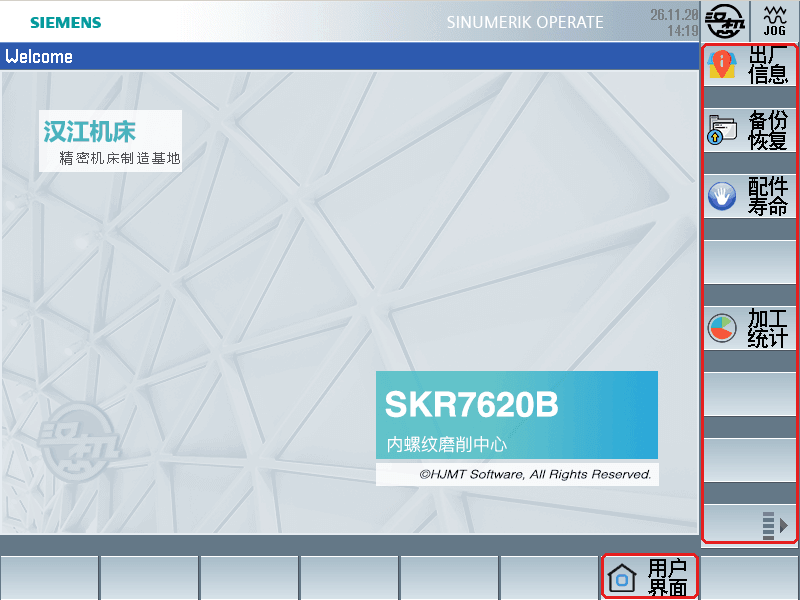
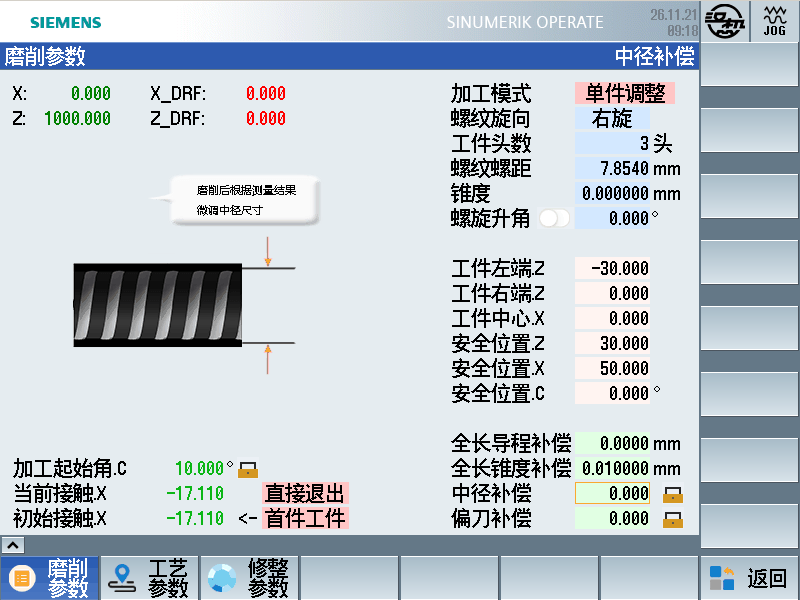
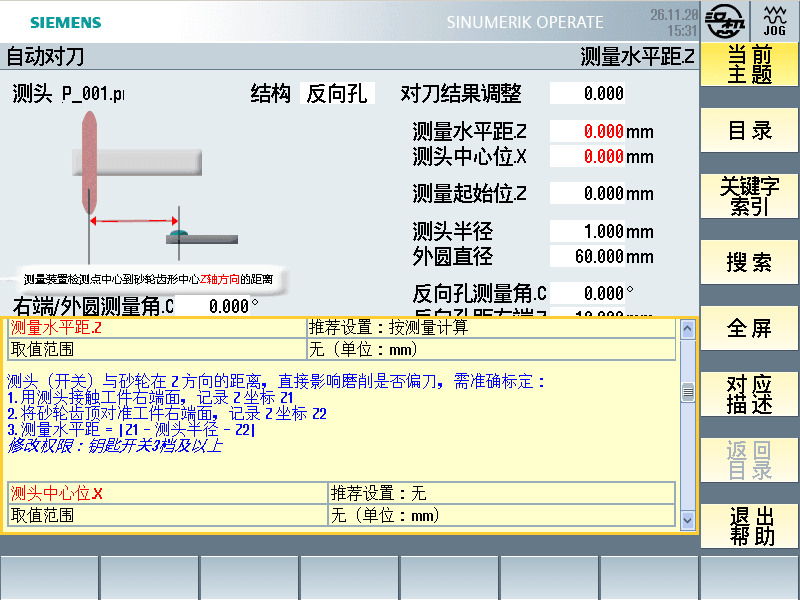
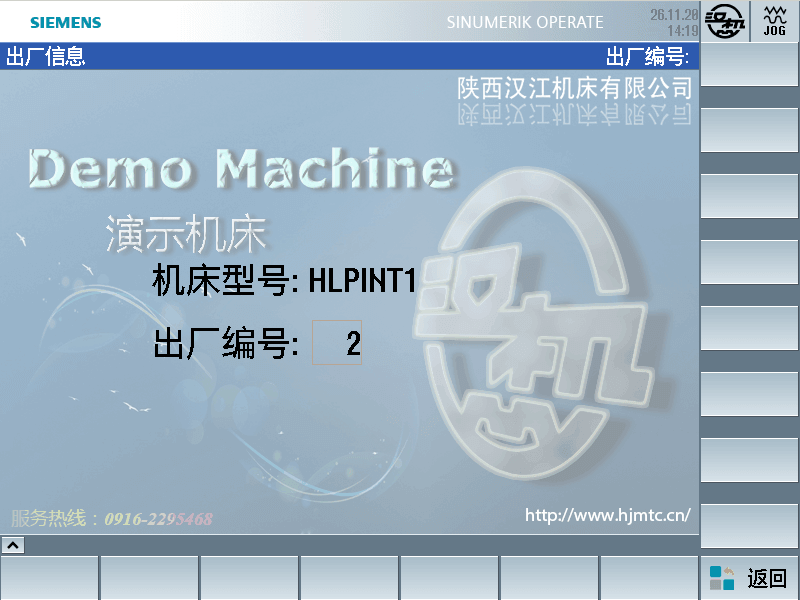

[HMI界面参数定义](index.html)

---

欢迎页与界面导航

---

按操作面板上的 **CUSTOM** 键进入机床专用界面，首先显示欢迎页

---

欢迎页

---

  
红框：右侧为欢迎页功能软键（备份恢复、配件寿命、加工统计需在机床配置中开启后才显示）；下方 **用户界面** 软键进入加工参数界面  

欢迎页显示机床型号与名称。右侧软键：  
**出厂信息**：查看机床型号、出厂编号和服务联系方式  
**备份恢复**：参数备份与恢复（需用户口令，机床配置中开启后显示）  
**配件寿命**：配件使用次数管理（机床配置中开启后显示）  
**加工统计**：砂轮加工数量统计（钥匙开关 3 档，机床配置中开启后显示）  
最下方 ▷ 软键切换到扩展菜单（**机床配置**，需用户口令），再按一次返回  
屏幕下方 **用户界面** 软键进入磨削参数等加工界面

用户界面导航

---

  

用户界面底部的水平软键切换各参数页面：  
**磨削参数**：工件与位置参数、补偿，及空运行/分段补偿/螺距变换等扩展功能  
**工艺参数**：粗磨、半精磨、精磨、终磨工艺表  
**修整参数**：砂轮修整参数，及齿形、修整轮参数  

**自动对刀**：自动对刀测量参数  

**返回**：回到欢迎页  
各页面中选中参数后按操作面板上的 **HELP** 键，可直接打开该参数的帮助说明

  

上图：在自动对刀界面选中"测量水平距.Z"后按 HELP 键，下半屏直接显示该参数的帮助；右侧软键可切换全屏、目录、搜索，按"退出帮助"返回

操作面板功能键

---

按 **循环启动** 后，程序按机床操作面板上点亮的功能键决定本次执行的内容：  
**修整**：只修整砂轮，不对刀、不磨削（与对刀键同时点亮时也只执行修整）  
**手动对刀**：执行手动对刀，见[对刀](section_11.html)  

**自动对刀**：执行自动对刀（与手动对刀键同时点亮时按自动对刀执行）  

**C 轴旋转**：砂轮启动，头架持续旋转，不执行修整、对刀和磨削，按复位键停止  

**退刀**：修整、对刀或磨削过程中按下，程序中止当前动作，砂轮安全退出工件后结束（手动对刀时用它结束对刀）  
功能键都不点亮时按循环启动执行磨削  
磨削界面打开 **空运行使能** 时优先执行空运行热机，不执行其它内容  

内螺纹机床打开 **自磨夹具** 时只执行夹具磨削

操作权限

---

参数修改受系统访问权限控制，权限不足时参数只能查看不能修改：  
**钥匙开关 0 档**：中径补偿、偏刀补偿、全长补偿等日常调整参数  
**钥匙开关 3 档**：工件、工艺、修整、对刀等大部分加工参数，以及加工统计  
**用户口令**：备份恢复、机床配置入口  
**制造商口令**：机床配置中的全部项目  
每个参数的修改权限见其帮助说明中的"修改权限"

出厂信息

---

  

|  |  |
| --- | --- |
| 出厂编号 | 推荐设置：无 |
| 取值范围 | 由制造商设置 |

机床的出厂编号，与铭牌一致，报修或咨询时请提供此编号与机床型号  
*修改权限：用户口令及以上*
